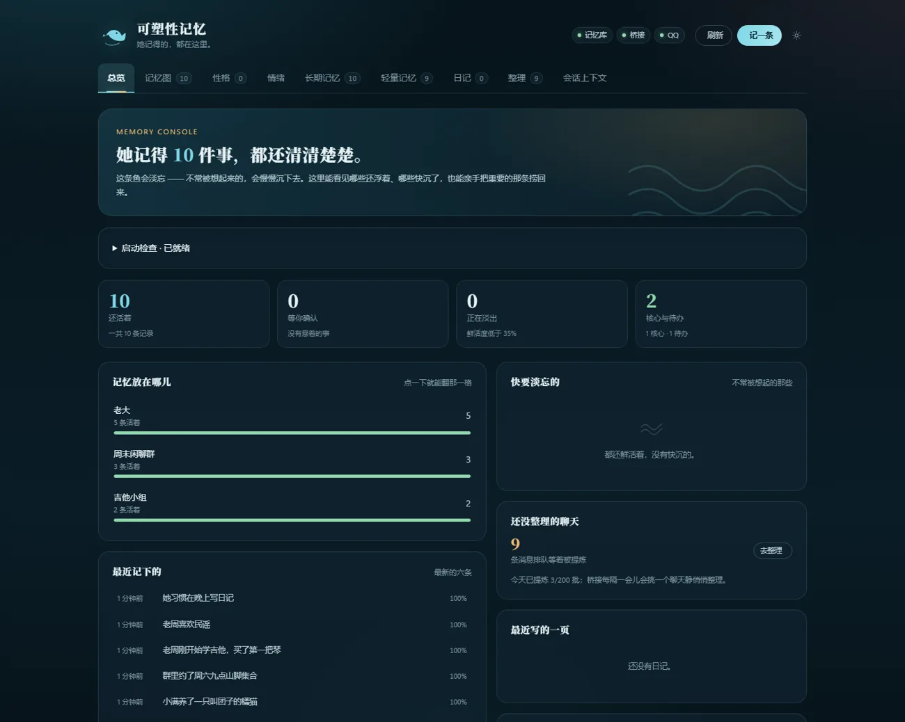
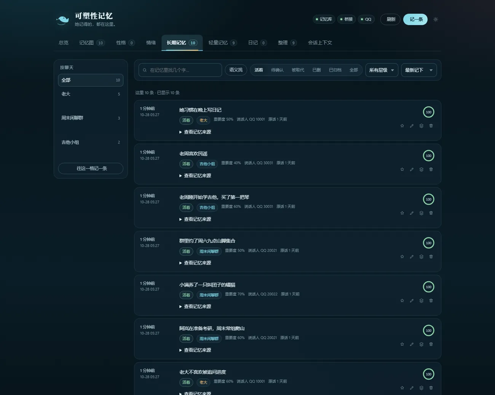
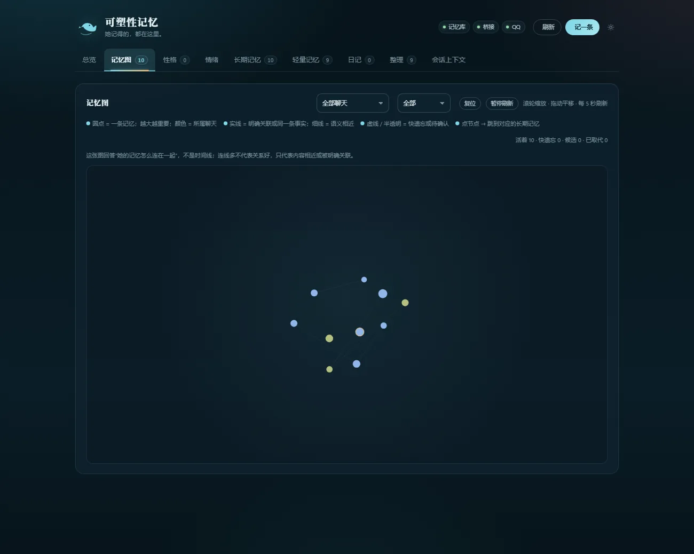
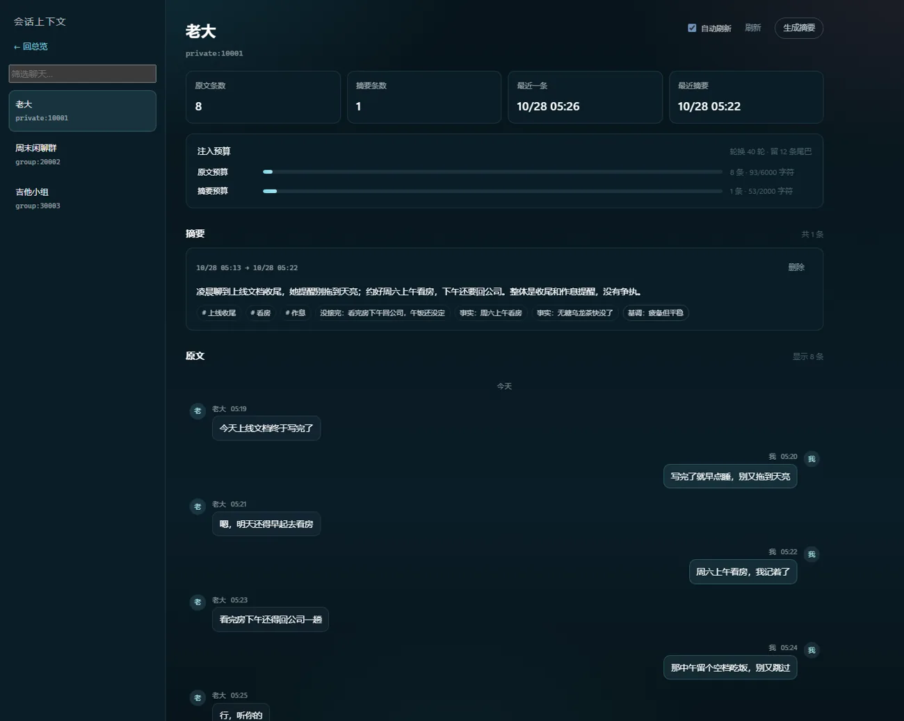
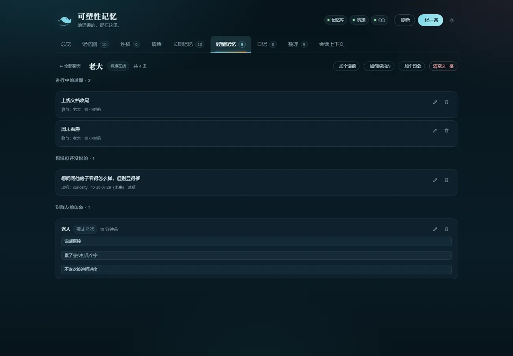
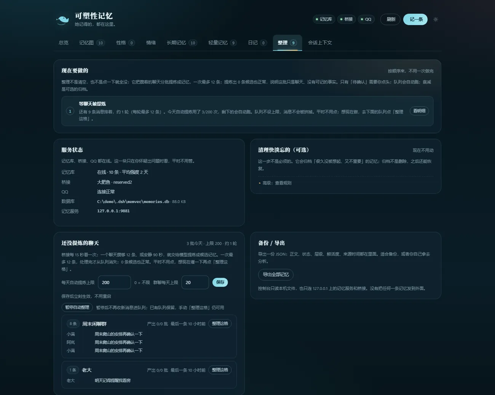
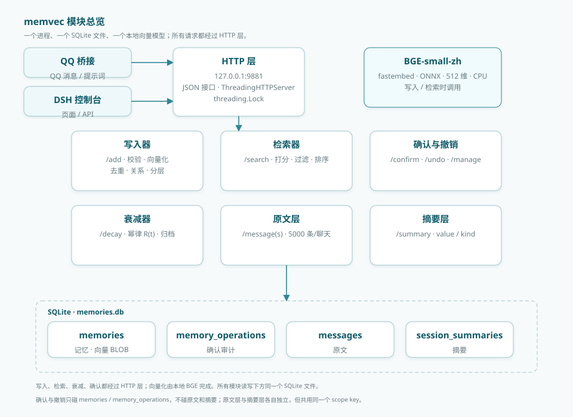

# 可塑性记忆

> 本地优先的 QQ 角色记忆控制台，DSH 插件形态。


把长期记忆、原文与摘要、日记、性格和情绪放进同一个本地页面：能看、能改、能撤回。所有数据都在本机，不经过外部服务器。

[使用手册](manual/可塑性记忆-使用手册-0.7.2.pdf) · [memvec 技术说明](docs/memvec.md) · [更新日志](CHANGELOG.md) · [Release](https://github.com/swy55555/dsh-feiyu-memory-console/releases)

---

## 目录

- [功能](#功能)
- [截图](#截图)
- [环境要求](#环境要求)
- [安装](#安装)
- [配置](#配置)
- [使用](#使用)
- [数据与隐私](#数据与隐私)
- [常见问题](#常见问题)
- [开发与测试](#开发与测试)
- [已知限制](#已知限制)
- [文档](#文档)
- [许可证](#许可证)

## 功能

| 模块 | 说明 |
|---|---|
| 总览 | 记忆总量、聊天分布、最近记忆、待整理队列、日记入口、称呼设置 |
| 长期记忆 | 按聊天/状态/层级筛选，搜索，新增，改重要度，确认候选，归档，删除，导出 |
| 记忆图 | 记忆关联可视化，支持宇宙/大脑/简洁三种视图，可缩放、平移、按聊天/层级/状态过滤 |
| 语义搜索 | 本地向量检索，不调用外部模型 |
| 轻量记忆 | 进行中的话题、没说出口的想法、群友印象 |
| 整理队列 | 查看队列、手动提炼、调整每日/群聊额度、暂停自动整理 |
| 日记 | 公开本可读可改可补；私密本加密，需要密码解锁 |
| 性格 | 查看/编辑维度、底色、边界，从角色卡起草，按聊天微调，撤销变化 |
| 情绪 | 核心情绪、心情、长期底色三层，情绪盘、触发链、微调审计 |
| 情景记忆 | 事件、解释、情绪、行动、结果，支持补结果和删除 |
| 会话上下文 | 原文层与摘要层：看最近原文/摘要、手动生成、删除写坏的摘要 |
| 主动联系 | 时间窗内按概率主动找你；太久没理她会掉心情、带小脾气 |
| 催睡觉 | 到点催睡；催了还不睡会闹脾气 |

写操作都有审计。记忆删除、公开日记修改、候选确认支持撤销；衰减归档没有整批撤销入口。

## 截图

截图来自纯合成演示库，人名、QQ 号、对话均为虚构。

| 总览 | 长期记忆 |
|---|---|
|  |  |

| 记忆图 | 会话上下文 |
|---|---|
|  |  |

| 轻量记忆 | 整理 |
|---|---|
|  |  |

memvec 内部结构：



## 环境要求

| 组件 | 是否必须 | 说明 |
|---|---|---|
| DSH 桌面版 2.x | 是 | Node.js 24+ |
| memvec | 是 | 默认 `127.0.0.1:9881`，包内附源码 |
| QQ 桥接 | 完整功能需要 | 默认 `127.0.0.1:3100`，不在包内 |
| SnowLuma | 完整功能需要 | OneBot v11 网关，第三方软件 |
| QQ 账号 | 完整功能需要 | 自行登录 SnowLuma |

包内不含 QQ 桥接、SnowLuma、QQ 账号，也不含记忆数据库和模型缓存。

## 安装

### 1. 安装插件

在 DSH 的 **设置 → 插件 → 安装** 里选择本包，或本地开发时填写：

```text
link:C:\Users\<用户名>\.dsh\plugins\dsh-feiyu-memory-console
```

装完重启一次 DSH。页面资源每次请求读取，但宿主路由在启动时加载，**更新插件后也要重启**。

### 2. 启动 memvec

`memvec` 是独立 Python 服务，不会随 DSH 自动启动。

```powershell
cd <插件目录>
npm run doctor
python -m pip install -r memvec/requirements.txt
npm run start:memvec
```

`doctor` 只检查，不安装依赖、不下载模型。首次启动会下载 `BAAI/bge-small-zh-v1.5`（约 90MB），之后离线加载。

确认：

```powershell
curl.exe http://127.0.0.1:9881/stats
```

返回 `{"ok":true,...}` 即正常。

### 3. 启动 QQ 桥接

```powershell
cd ~/.dsh/qq-bridge
node src/bridge.js
```

确认：

```powershell
curl.exe http://127.0.0.1:3100/api/status
```

### 4. 给桥接打补丁

原文/摘要和主动联系都需要桥接补丁。**不在插件目录时，先 `cd` 到插件目录。**

```powershell
# 上下文层：原文 / 摘要 / 会话轮换
node bridge/install.mjs --target "$env:USERPROFILE\.dsh\qq-bridge" --check
node bridge/install.mjs --target "$env:USERPROFILE\.dsh\qq-bridge" --apply

# 主动联系 / 催睡（可选）
node bridge/install-owner-contact.mjs --target "$env:USERPROFILE\.dsh\qq-bridge" --check
node bridge/install-owner-contact.mjs --target "$env:USERPROFILE\.dsh\qq-bridge" --apply
```

- `--check` 报 `incompatible` 就不要 `--apply`：说明 `bridge.js` 与补丁版本不匹配，先看 [UPGRADE.md](UPGRADE.md)。
- 补丁会备份原文件并写回执；撤销用 `--undo`。
- 如果桥接本身已内置对应逻辑，`--check` 会报 `already-inline`，不会重复插入。
- 打完补丁重启桥接。

### 5. 打开控制台

- 已装 DSH：`http://127.0.0.1:3080/dsh-feiyu-memory/`，或侧栏「可塑性记忆」
- 未装 DSH：`node bin/preview.mjs`，访问 `http://127.0.0.1:3999`

| 状态灯 | 红色时先查 |
|---|---|
| 记忆库 | memvec 9881 未启动或端口被占用 |
| 桥接 | QQ 桥接 3100 未启动 |
| QQ | 桥接连不上 SnowLuma，或 QQ 未登录 |

## 配置

桥接配置在 `~/.dsh/qq-bridge/config.json`；主动联系和催睡也可以直接在控制台「情绪」页改，保存到 `owner-contact.json`。

| 配置组 | 位置 | 说明 |
|---|---|---|
| 会话上下文 | `socialV2.context` | 原文/摘要注入上限、轮换轮数、重试间隔 |
| 整理队列 | `socialV2.dailyMemory` | 每日批次、队列上限、群聊策略 |
| 情绪 | `socialV2.emotion` | 长期漂移、聊天微调、权重、模型复核 |
| 主动联系 | `socialV2.ownerContact` 或 `owner-contact.json` | 时间窗、静默阈值、概率、闹脾气间隔 |
| 催睡觉 | `socialV2.bedtime` 或 `owner-contact.json` | 催睡时间、概率、闹脾气间隔 |

常用项：

| 字段 | 默认 | 作用 |
|---|---|---|
| `context.messagesChars` | `6000` | 每轮注入原文的字符上限 |
| `context.summaryChars` | `2000` | 每轮注入摘要的字符上限 |
| `context.rotateTurns` | `40` | 多少轮后考虑会话轮换 |
| `dailyMemory.maxCallsPerDay` | `200` | 每日提炼上限，`0` 为不限 |
| `ownerContact.idleHours` | `1.5` | 多久没说话开始按概率找你 |
| `ownerContact.probabilityPerCheck` | `0.15` | 每 5 分钟触发的基础概率 |
| `ownerContact.maxPerDay` | `16` | 每日主动联系上限 |
| `ownerContact.sulkCooldownHours` | `6` | 两次闹脾气的最小间隔 |
| `bedtime.time` | `24:00` | 催睡时间 |
| `bedtime.sulkCooldownHours` | `20` | 催睡闹脾气的冷却 |

完整字段和默认值见 [使用手册](manual/可塑性记忆-使用手册-0.7.2.pdf) 与 [bridge/P0-CONTEXT.md](bridge/P0-CONTEXT.md)。

## 使用

1. 先开 memvec，再开桥接，最后开 DSH。
2. 「总览」看记忆总量和待处理项。
3. 「长期记忆」确认候选、改重要度、看来源；「记忆图」看关联。
4. 「整理」查看队列、调额度、手动提炼。
5. 「情绪」调主动联系和催睡；「会话上下文」看原文和摘要。
6. 「日记」「性格」「情景记忆」按需修改，写操作都有审计。

## 数据与隐私

| 数据 | 路径 |
|---|---|
| 长期记忆、原文、摘要 | `~/.dsh/memvec/memories.db` |
| 轻量记忆 | `~/.dsh/qq-bridge/state/social-v2.json` |
| 整理队列 | `~/.dsh/qq-bridge/state/daily-memory-queue.json` |
| 公开日记 | `~/.dsh/whale-diary.md` |
| 私密日记 | `~/.dsh/feiyu-memory-console/private-diary.vault.json` |
| 性格 / 情绪 / 情景 | `~/.dsh/feiyu-memory-console/` |
| 主动联系 / 催睡 | `~/.dsh/qq-bridge/owner-contact.json` |
| 审计日志 | `~/.dsh/feiyu-memory-console/audit.jsonl` |

- 只监听 `127.0.0.1` / `::1`，没有外部入口。
- 写操作要求 `x-feiyu-console: 1` 请求头和同源校验。
- 前端无框架、无外部 CDN。
- 私密日记 AES-256-GCM 加密，不会自动进入 QQ 记忆。
- 私密日记密码明文保存在桥接的受限文件里，管理员可读；它是防随手翻的软加密。

备份记忆库只需要复制 `memories.db`。不要分享 SnowLuma token、桥接 console token 或含白名单的配置。

## 常见问题

| 现象 | 原因 / 处理 |
|---|---|
| 控制台是空的，没有原文/摘要 | 桥接没打上下文补丁；运行 `bridge/install.mjs --apply` 后重启桥接 |
| 情绪页没有「主动联系」或「催睡觉」 | 桥接没有 `owner-contact` capability；运行 `bridge/install-owner-contact.mjs --apply` 后重启桥接 |
| 保存主动联系/催睡 404 | DSH 还跑着旧路由；重启一次 DSH |
| 记忆库红 | memvec 9881 未启动，运行 `npm run start:memvec` |
| 桥接红 | 桥接 3100 未启动 |
| QQ 红 | 桥接连不上 SnowLuma，或 QQ 未登录 |
| `--check` 报 incompatible | 桥接版本和补丁不匹配，先看 [UPGRADE.md](UPGRADE.md)，不要强装 |

`npm run doctor` 会检查 Node、Python、记忆服务依赖、桥接能力、上下文补丁和主动联系支持情况。

## 开发与测试

```powershell
# 本地预览
node bin/preview.mjs

# 同步 memvec 源码
node scripts/sync-memvec.mjs
node scripts/sync-memvec.mjs --check

# 全套测试
npm test

# 单独运行
node test/features.test.mjs
node test/host.test.mjs
node test/diary.test.mjs
node test/audit.test.mjs
node test/p0-context.test.mjs
python test/memvec_test.py
python test/p0-context-test.py

# 浏览器回归（需要 Playwright）
node test/browser.test.mjs
```

`npm test` 跑七组隔离测试：插件路由、性格/情绪/情景、日记、审计、真实本机 HTTP 集成、上下文工程、Python 记忆生命周期。Python 测试使用固定向量，不下载模型、不连 QQ。

## 已知限制

- 包内不含 QQ 桥接、SnowLuma 和 QQ 账号。
- 没有桥接时，整理队列、情绪演化、私密日记等桥接功能不可用。
- 私密日记只支持查看和补页，不支持编辑。
- 记忆图最多加载 800 条，跨页不绘制边。
- 情绪 appraisal 基于规则，对反讽和复杂上下文可能误判。
- 情景记忆的行动和结果是启发式回填，不是完整因果模型。
- 没有移动端专门布局。

## 文档

- [使用手册（PDF）](manual/可塑性记忆-使用手册-0.7.2.pdf)：逐页功能说明、配置和排查
- [memvec 技术说明](docs/memvec.md)：技术选型、数据模型、检索与遗忘公式、参考文献
- [上下文层说明](bridge/P0-CONTEXT.md)：原文、摘要、轮换和预算
- [更新日志](CHANGELOG.md) · [升级说明](UPGRADE.md)

## 许可证

MIT
