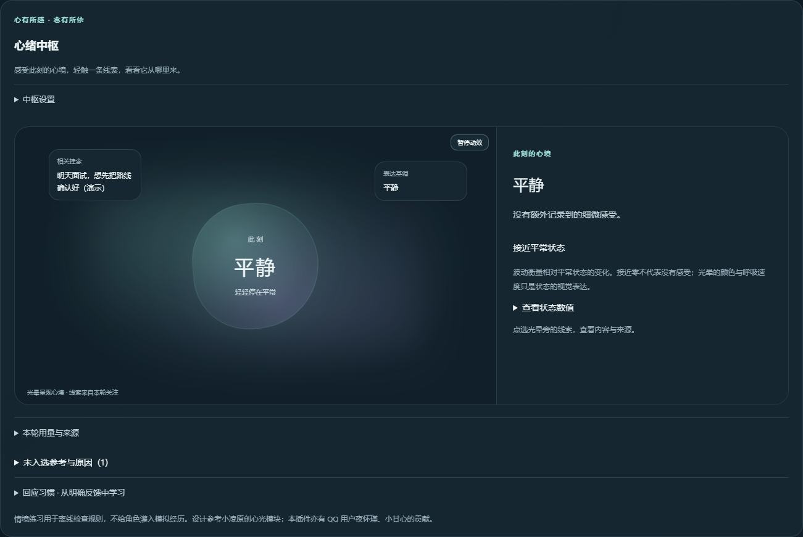
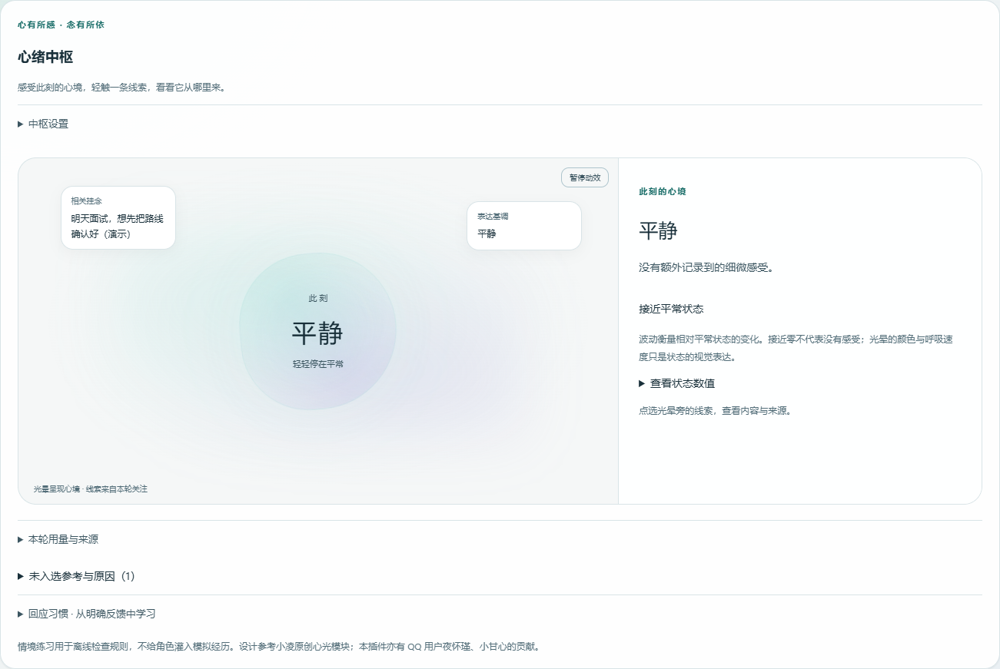

# 心迹 · 可塑性记忆

基于经历、可塑记忆和当前心绪的陪伴系统，由心迹桥接与可塑性记忆协同工作，运行于已有 DSH 与 QQ/SnowLuma 环境。集中查看和维护长期记忆、聊天原文与摘要、日记、性格和情绪，提供来源核对、处理进度和可撤销的维护操作。


[下载 v0.10.1](https://github.com/swy55555/dsh-feiyu-memory-console/releases/tag/v0.10.1) · [用户手册](manual/USER_GUIDE-0.10.1.md) · [PDF 手册](manual/USER_GUIDE-0.10.1.pdf) · [升级指南](UPGRADE.md) · [更新日志](CHANGELOG.md)

**v0.10.1 正式版**包含可选成长课堂、省心整理、按内容变化的记忆保留、情绪与共享范围修复，以及审核结果复用。继续保留六维性格、可成长自我参考、自然表达规则、QQ 通信与二代仿真兼容层和玩梗功能。

省心整理的预览、已有审核复用及主动归档不新增模型调用；归档后不参与正常检索，不能用归档代替确认。尚未实现把所有候选自动转为可检索经历或无人工确认的新版流程。详见[整理操作说明](docs/memory-organizer.md)与[费用边界](docs/memory-cost-growth.md)。

## 项目定位

当前桥接产品名为 **心迹桥接**，启动入口、运行引擎身份和管理界面均使用心迹。可塑性记忆提供记忆服务与控制台，和心迹协同管理经历、心绪与成长。

心迹沿用并改造了原 QQ 桥接的通信适配、白名单和二代仿真等能力；这是底层兼容来源，不表示需要另外运行一套旧 QQ 桥接，也不表示全部底层代码已重新编写。文档中的“原 QQ 桥接”仅用于来源和迁移说明。

**本包不是包含 DSH、QQ、SnowLuma 和全部依赖的一键安装包**。插件包含控制台、独立记忆服务源码及心迹运行时更新模块。已有原 QQ 桥接用户可按升级指南迁移到心迹。

`qq-bridge` 是沿用的目录及部分配置路径名称。下文安装命令仍使用这个实际路径，不能只为统一名称而直接重命名目录，否则可能影响启动脚本、配置和状态读取。

数据库和状态文件默认保存在本机。聊天、提取、摘要、遗漏检查及启用后的语义复核会向所配置的模型服务发送相关文本；“本地保存”不代表全部功能都离线运行。

## 主要功能

| 功能 | 可以做什么 |
| --- | --- |
| 长期记忆 | 按聊天、状态、层级筛选；查看原话、确认候选、编辑、归档、恢复、删除和导出 |
| 自动候选核对（可选） | 主人私聊候选自动检查原话和历史关系，明确支持才确认；保留审计与撤销，不自动覆盖旧事实 |
| 事实核对 | 区分共存、补充、重复与冲突；确认和恢复分批检查旧事实，进度保存，可中断续接 |
| 提取与查漏 | 从允许的聊天整理个人事实；独立检查遗漏，失败或未完成的消息保留续处理 |
| 成长课堂（可选） | 自建课程、手写参考或单次模型草案，核对后按需采用；默认关闭，不循环训练 |
| 省心整理 | 本地预览、全选、复用完整审核、主动归档和整批撤销；不新增模型调用 |
| 整理记录 | 查看近期消息的排队、检查、遗漏、重试和提取时状态；调整批次额度 |
| 检索与记忆图 | 本地语义检索、来源证据与可视化关联；区分检索预览和实际回复使用记录 |
| 原文与摘要 | 查看会话原文、摘要及回复上下文，手动生成或删除不准确的摘要 |
| 性格与情绪 | 维护角色底色和边界；查看事件驱动的情绪变化，理解日常感受与复杂情境 |
| 日记与情景 | 管理公开日记、查看私密日记及补页；查看事件、解释、情绪与结果 |
| 主动联系与催睡 | 配置时间窗、概率、次数和冷却；满足条件时由桥接发起联系 |
| 轻量记忆与玩梗 | 查看同聊天已确认信息、自动近期便签、临时话题和印象，管理可选梗库功能；梗库需另行准备 |
| 用量与审计 | 按功能查看累计与所选时段的 token、估算花费和用量记录；查看审计和可撤销操作 |
| 心绪中枢 | 每轮最多五条、2400 字符的参考；展示来源、取舍和去向；可选从明确反馈学习六种回应方式 |
| 当前心绪（试验） | 连续事件理解、挂念生命周期、可修正认识、关系观察与回复去向；支持查看来源、暂停、结束和否定 |
| 空闲联想（试验） | 主人私聊空闲时，从同一聊天真实记忆出发形成短程话题设想、显示去向；可独立开启轻微主观感受，默认关闭 |

不同对象的偏好不应仅因同属“饮食”而互相覆盖。例如“不喜欢煎饼”和“喜欢小笼包”可以同时成立。模型仍可能判断错误，请以原话和实际情况为准。

## 本版更新重点

- [成长课堂](docs/growth-classroom.md)：用户自建课程，免费手写参考；模型草案可复用，核对后才生效，不是模型权重训练。
- [省心整理](docs/memory-organizer.md)：按聊天预览和批量选择；按建议处理与主动归档分开，保留原话、版本检查与撤销。歧义仍保留待确认。
- [记忆保留](docs/content-retention.md)：按内容、重要性和有效间隔经历调整，所有聊天同一规则；工程参数不等同于人类记忆测量，旧数据迁移有14天建议归档保护。
- [调用复用](docs/call-reuse-audit.md)：审核只补变化项，提取与查漏分别复用，联想合并生成；不承诺固定节省比例。
- [情绪与共享范围](docs/memory-emotion-isolation.md)：按对象保存事件、关系与冲突，整体心境可汇总影响表达；跨聊天记忆与参与摘要经过隐私过滤，页面可查看和撤销范围。
- [交流理解](docs/conversation-understanding.md)：结合双方近期原话，改善反馈和日常感受处理，保留可修正依据；仍可能误解，不代表读心或真实意识。
- [心迹管理界面](docs/xinji-ui.md)与[首次启用向导](docs/first-use.md)：柔和心境风格、深浅主题、手机导航、浏览器令牌复用与已有状态保护。

已有用户需同步升级插件、桥接运行时与独立记忆服务。升级保留配置，不自动开启成长课堂、自动候选审核等付费功能。发布包不包含发布者的聊天、人格、数据库或令牌。

## 界面预览

以下为沿用的 v0.9.1 心绪中枢合成数据截图，不展示真实用户对话。可视化和文字列表读取同一状态；查看页面不会调用模型。

| 深色心绪 | 浅色心绪 |
| --- | --- |
|  |  |

## 环境要求

| 组件 | 要求与用途 |
| --- | --- |
| Windows | 当前主要验证平台；其他系统未完成完整联调 |
| DSH | 支持本项目插件接口的版本；基于现有 DSH NEXT 环境验证，不承诺全部宿主版本兼容 |
| Node.js | 24 或更新版本，使用内置 SQLite 功能 |
| Python | 3.10 或更新版本；依赖见 `memvec/requirements.txt` |
| memvec | 独立记忆服务，默认 `127.0.0.1:9881` |
| 心迹桥接 | 负责 QQ 接入、调度和成长功能；沿用原通信适配与所需 SDK，默认管理端口 3100 |
| SnowLuma / QQ | QQ 收发链路需要，由使用者另行部署和登录 |
| 模型服务 | 提取、查漏、摘要和可选复核需要已配置的聊天模型 |

## 安装与升级

已有安装先阅读 [升级指南](UPGRADE.md)。只更新网页不能更新桥接或独立 memvec 服务。

1. 下载 `.tgz` 插件包或 `-source.zip` 完整源码，核对附件 SHA-256。
2. 按当前 DSH 的本地插件安装入口安装本包。源码链接开发应指向实际解压目录。
3. 在插件目录检查环境并准备记忆服务：

```powershell
npm run doctor
python -m pip install -r memvec/requirements.txt
npm run start:memvec
```

`doctor` 只检查。首次启动可能下载向量模型；已有数据库应继续使用原路径，不能误建空库。

4. 备份并停止已有桥接，在插件目录检查兼容性，再安装统一运行时：

```powershell
node bridge/install-all.mjs --target "D:\your-dsh\qq-bridge" --check
node bridge/install-all.mjs --target "D:\your-dsh\qq-bridge" --apply
```

将示例替换为实际桥接目录。未知或自定义运行时会拒绝覆盖，应先检查差异。

5. 确认独立服务使用本包的 `memvec/server.py`，启动 memvec、DSH 和桥接。打开“可塑性记忆”，在总览检查版本和服务状态。

默认本机网页地址为 `http://127.0.0.1:3080/dsh-feiyu-memory/`，实际端口以 DSH 配置为准。完整路径核对与新手步骤见手册。

## 首次使用

0.10.1 提供“心迹运行总览 → 启用与成长”向导，检查服务、说明成长功能的费用，并保护已有性格与经历。操作详见 [第一次使用](docs/first-use.md)；它不替代 QQ、DSH 和心迹所需通信依赖的部署。

1. 总览完成启动检查，确认数据库路径一致、桥接在线。
2. 在允许的聊天中正常交流；群聊默认只处理 @ 或回复机器人的消息。
3. “整理”查看队列和“消息处理状态与遗漏检查”；普通闲聊可能没有新增事实。
4. “长期记忆 → 待确认”核对原话。先区分明确矛盾与尚不确定；内容都成立时选“确认这条，并保留全部已有记忆”。
5. “语义找”检查检索结果；控制台预览不证明 QQ 回复已经使用这些记忆。
6. 按需调整情绪复核、主动联系和试验功能。详细操作见 [用户手册](manual/USER_GUIDE-0.10.1.md)。

## 模型调用与配置

提取一批消息通常有一次提取和一次独立查漏调用；遗漏续处理会增加调用。确认/恢复时，每八条旧事实可能增加一次复核。情绪模型开启后，符合条件的普通主人私聊也可理解感受，未取得共享判断时最多补一次独立调用，计入“情绪复核”；空闲联想通常两次，有明确用途时最多三次调用。连续事件理解开启后，每条合格的主人私聊消息最多新增一次调用，计入“事件理解”；成功时复用情绪分类，不设每日调用硬上限。

整理额度按成功批次计，不等于模型请求次数或 token 上限；`0` 表示不限。新环境的总额度默认不限，群聊仍有独立额度和低产出暂停。**升级保留已有配置**，不会把已有数值强制改为不限。情绪模型复核的每日不限与记忆整理额度是两套设置。候选自动核对默认关闭，每分钟最多一条候选或一批历史，新增“候选核对”分项；历史关系沿用“事实复核”分项。自动核对仍可能语义误判，可关闭并在审计中撤销已确认操作。实际费用以模型服务账单为准。

回应倾向学习复用事件理解调用，不另发请求；学习提示、历史反馈和结果会增加 token，计入“事件理解”。聊天模型收到的参考计入聊天费用，不能将这两项重复记账。上限是字符或条数，不是 token 额度。

自动近期便签复用原有记忆提取调用，会增加少量提示与输出 token；同聊天已确认信息直接读取本地数据库，不调用模型。

## 数据与隐私

- 默认数据根目录为 `~/.dsh`。长期记忆、原文与摘要在 `memvec/memories.db`，整理队列在 `qq-bridge/state/daily-memory-queue.json`。
- 回应反馈及撤销记录保存在 `qq-bridge/state/response-patterns.json`；本轮关注仅在内存中保留，重启不会恢复旧关注。
- 连续心绪及其原话证据保存在 `qq-bridge/state/continuity.json`，需随桥接状态一起备份。
- 配置、日记、性格、情绪与审计记录分布在桥接和 `feiyu-memory-console` 目录；备份不能只有插件源码。
- 数据库运行时可能存在 WAL/SHM 文件。应使用 SQLite 在线备份，或停止服务后备份完整数据，不能把运行中单独复制 `.db` 视为一致备份。
- 原文按聊天保存；开启共享后，普通事实和旧 global 经隐私审核自动可用，私密与不确定内容不自动共享。心情全局共享，关系态度按对象分别记录。见[范围与迁移说明](docs/memory-emotion-isolation.md)。
- 私密日记使用加密存储，但本机管理员或持有解锁材料者仍可能读取，不等同于端到端加密。
- 不公开真实聊天库、模型密钥、控制台令牌、QQ 白名单或用户日志。

## 已知限制

- 模型提取、查漏与语义判断仍会出错；独立检查不是完整性或准确率保证。
- 大量历史需要多批调用；中断可续接，事实发生相关变化时需重新检查。
- 最近最多 500 条处理记录中的事实状态为提取时快照；当前状态以长期记忆页为准。
- 超过 12000 字的消息保留待拆分；队列容量达到上限时，移出项会留下状态。
- 情绪理解使用有限规则和上下文，复杂反讽、指代和角色扮演仍可能误判。
- 空闲联想是有限的候选话题机制，不代表持续自主思考，质量和重复话题需要观察。
- 待验证认识会淡化、过期，不能自动变成事实或人格；不同措辞是否属于同一次经历仍可能误判。
- 审计不等于所有操作都能撤销；已发送消息不会因记忆撤销自动收回。

## 开发与发布

```powershell
npm test
npm run test:browser
npm run test:browser:context
npm run test:browser:usage
npm run test:browser:continuity
npm run test:browser:ui
npm run test:browser:mind
npm run test:browser:light
npm run simulate:everyday
npm run simulate:mind
```

基础回归包含 30 组隔离测试。浏览器测试另需 Playwright 和兼容浏览器；测试使用隔离数据，不向 QQ 发消息。[发布规范](docs/RELEASING.md) 说明版本、标签、测试、附件、校验和草稿发布流程。

反馈问题时请附版本、操作步骤、期望与实际结果，以及去除个人信息后的错误信息。

## 来源与贡献

心绪中枢参考小凌原创「心光」模块及相关设计，经本项目融合、删减与独立实现。本插件亦有 QQ 用户夜怀瑾、小甘心的贡献。 详细说明见 [致谢](ACKNOWLEDGEMENTS.md)。

## 文档与许可

- [详细用户手册](manual/USER_GUIDE-0.10.1.md) / [PDF](manual/USER_GUIDE-0.10.1.pdf)
- [升级与回退](UPGRADE.md) / [更新日志](CHANGELOG.md)
- [情绪与复杂情境](docs/complex-emotion.md) / [记忆服务说明](docs/memvec.md)
- [致谢与来源](ACKNOWLEDGEMENTS.md) / [免责声明](DISCLAIMER.md)

本项目采用 [MIT 许可证](LICENSE)，为独立开源项目，与 DeepSeek、DSH、腾讯 QQ、SnowLuma 或模型服务商无官方隶属关系。使用第三方服务时，应遵守其协议和适用要求。

本版新增 [可成长的自我参考](docs/self-reference.md)：保留权限规则，从可追溯交流形成暂定倾向，支持淡化、撤回和版本恢复。


### 情境文风学习（开发版）

独立的“成长课堂”支持＋新建课程、零调用手写参考、单次模型整理和用户核对后按需使用。默认关闭，同样材料复用草案，不循环自评；旧表达教师与文风蒸馏不再自动运行。课程参考不是事实、人格或模型权重训练。费用单列“成长课堂”。操作、成本边界和科研依据见[成长课堂](docs/growth-classroom.md)。


## 可选审核范围

本版保留默认全量审核，也提供显式开启的相关范围模式：审核选入的同方面事实和少量语义近邻，可能漏掉范围外冲突。页面显示的“审核通过”仅指当前选定范围；原话、有效期和版本检查仍保留。详见[配置与限制](docs/review-scope.md)。此模式不等于所有候选自动生效。
