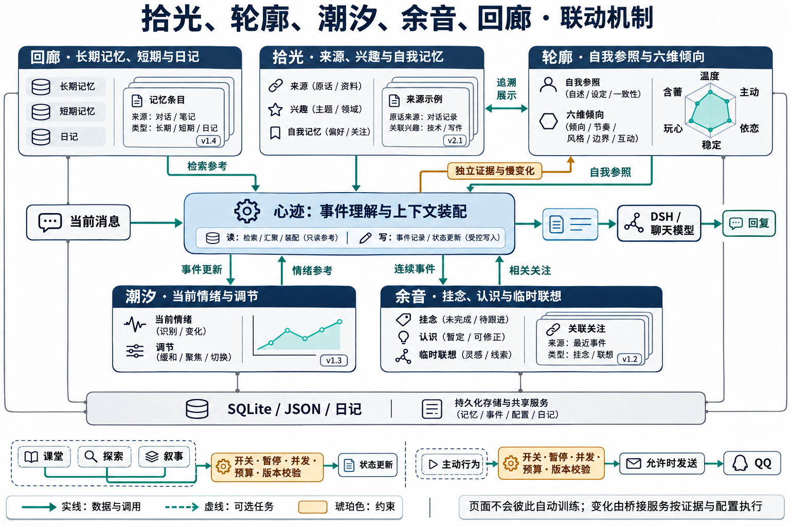

# 回响 / 心迹

**从聊天驱动，走向有边界的自我驱动。**

收到消息、检索记忆、生成回答，是一个起点。回响与心迹尝试再向前走一步：让对话留下可追溯的经历，让尚未结束的事延续为关切，让下一次回应有上下文；在你允许的范围内，也能在没有新消息时联想、探索、整理，并在条件满足时主动联系。

这里的“自我驱动”指**由已有状态和调度条件发起任务**：有候选、有开关、有预算、有暂停、有来源检查。它不意味着人的意识，也不意味着全天持续思考或所有后台能力默认开启。

## 0.11.4：让聊天中的探索留下可核对的经历

0.11.4 在 0.11.3 的来源检索与主动行为基础上，补全拾光的主人私聊入口：角色想按话题看 B 站时，可选择调用 `qq_shiguang_explore` 读取可用字幕；想读普通网页时，可用 `qq_shiguang_read_web` 读取正文。搜索结果只用于发现链接，成功读取正文或字幕才有来源回执；只有通过原文校验的摘录才会成为自我记忆。主人分享、关键帧、观众反馈与个人兴趣仍按各自的证据和预算边界运行。已有用户可以从旧人设卡预览并重建六维起点，保存前会明确警告覆盖身份／来历理解并备份原状态。机制和边界见 [用户手册](manual/USER_GUIDE.md)、[技术手册](docs/TECHNICAL_MANUAL.md) 与 [更新日志](CHANGELOG.md)。这不代表公布了新的回答正确率，也不保证每种问法都能答对。

## 不只是把聊天记录存下来

| 从…… | 走向…… | 仍然保留的边界 |
| --- | --- | --- |
| 这轮问了才检索 | 有关切与有限的空闲联想，准备未来可能相关的参考 | 联想有来源、时效和开关，不自动成为事实 |
| 固定角色描述 | 带证据的自我参照与缓慢变化的倾向 | 不训练基础模型权重；可查看、编辑与撤回 |
| 单次情绪标签 | 事件理解、短期状态、恢复与调节 | 工程参数不是心理测量，语义可能误判 |
| 结束对话就结束任务 | 可选的探索、课堂、叙事与主动行为 | 候选计算、实际执行、对外发送分别受控 |
| 看不到回答从何而来 | 来源、记忆、参考投递与用量的可检查记录 | 可追溯不等于模型结论一定正确 |

## 五个视角，一套相互关联的状态

- **拾光**：看来源脉络、兴趣证据与自我记忆，追问“这条印象从哪里来”。
- **轮廓**：看自我参照与六维倾向，理解哪些经历被采纳、哪些变化可以修正。
- **潮汐**：看此刻的情绪、调节与恢复，把短期波动和长期变化分开。
- **余音**：看未结束的挂念、待验证认识与临时联想，让对话之间保留连续性。
- **回廊**：管理长期记忆、短期状态、日记、整理队列、图谱与上下文。

年轮提供成长课堂；账本记录模型用量和费用估算；总览与梗库提供运行概况和表达素材。页面是同一套服务的不同观察入口，不是五个互相训练的独立智能体。

## 如何开始阅读

| 你想知道 | 入口 |
| --- | --- |
| 有哪些功能？会不会主动发消息？怎么关？多少钱？数据在哪？ | [详细用户手册](manual/USER_GUIDE.md) |
| 安装、升级、路径迁移、鉴权与工程排障 | [INSTALL](INSTALL.md) |
| 各模块输入输出、状态边界、联动图、实现索引与论文依据 | [技术手册](docs/TECHNICAL_MANUAL.md) |
| 这个版本改了什么、升级须知 | [更新日志](CHANGELOG.md) · [升级说明](UPGRADE.md) |
| 下载插件包、手册 PDF 与校验文件 | [GitHub Releases](https://github.com/swy55555/dsh-feiyu-memory-console/releases) |

本项目由 DSH 控制台插件、心迹桥接运行时和 memvec 组成，需要你自己的宿主、QQ 接入及模型配置。它不是包含全部环境的一键部署包，也不要求同时启用 Soul 或鱼的记忆。

## 关于默认行为、费用与隐私

代码回退值中，定时探索和叙事关闭，课堂需开启；主动决策默认只计算候选，默认不允许主动联系。已有安装会保留原配置，安装预设也可能不同，不能只看默认值判断你的当前行为。

插件本身以 MIT 提供；模型、平台与运行资源使用你自己的服务。后台功能执行时可能在没有新消息的情况下产生模型调用。账本和内部预算是估算，不能替代服务商账单或消费限制。

记忆主要保存在本地，但模型任务可能把相关消息和参考发送给配置的服务商；探索也会联网。不要将“本地存储”理解为“所有处理离线”。来源核对、会话隔离和鉴权能减少风险，不能消除所有模型错误或软件缺陷。

## 制作方式、免责声明与致谢

**除框架、第三方依赖及明确标注归属的代码和资源外，本项目自身代码采用 vibe coding（AI 辅助生成与迭代）方式制作。** 维护者负责功能取舍、集成与验证；测试通过不等于无缺陷或达到人类心理学意义上的能力。

使用前请阅读 [免责声明](DISCLAIMER.md)。感谢框架、开源依赖、研究作者与社区贡献者，具体归属见 [ACKNOWLEDGEMENTS](ACKNOWLEDGEMENTS.md)。本项目不代表这些项目或研究作者的认可、认证或背书。许可见 [LICENSE](LICENSE)。

## 安装包（0.11.4）

本版延续 0.11.2 起提供的完整包：心迹基础桥接、QQ MCP、依赖锁文件、Agent 预设和 DSH 注册脚本，可从空目录初始化。DSH、QQ 登录环境、模型服务和 Python 记忆服务仍需按环境配置。详见 [工程安装](INSTALL.md) 与 [交给 Agent 的完整安装指令](docs/AGENT_INSTALL.md)。已有用户请走 [升级流程](UPGRADE.md)，不要对旧数据目录执行首次安装。
