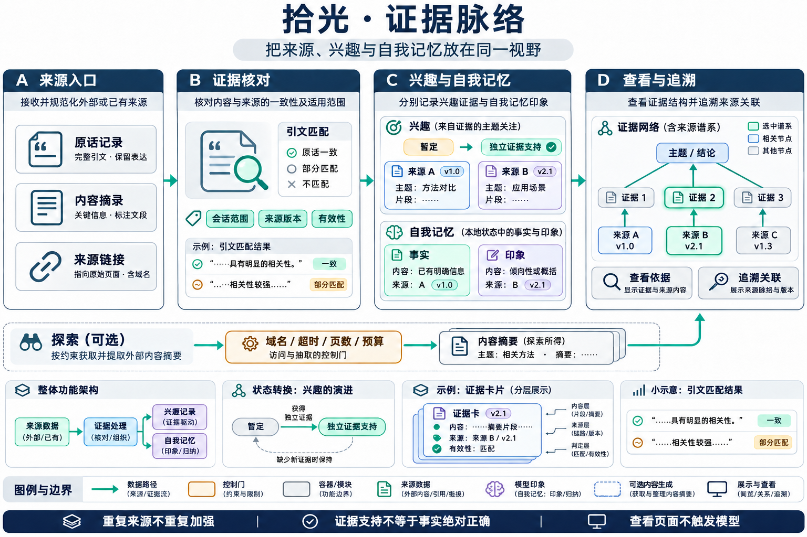
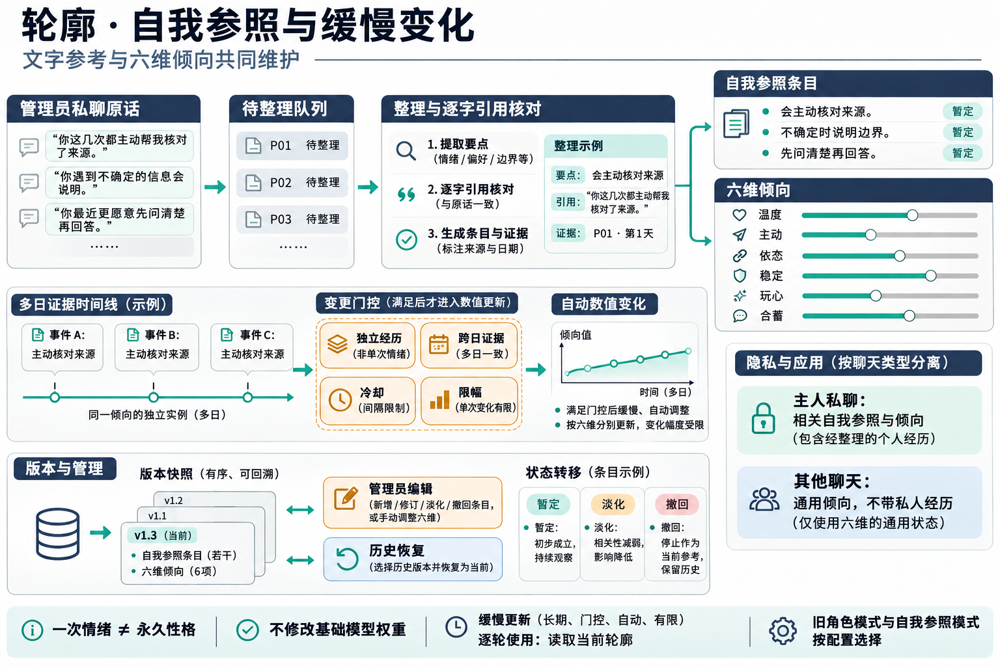
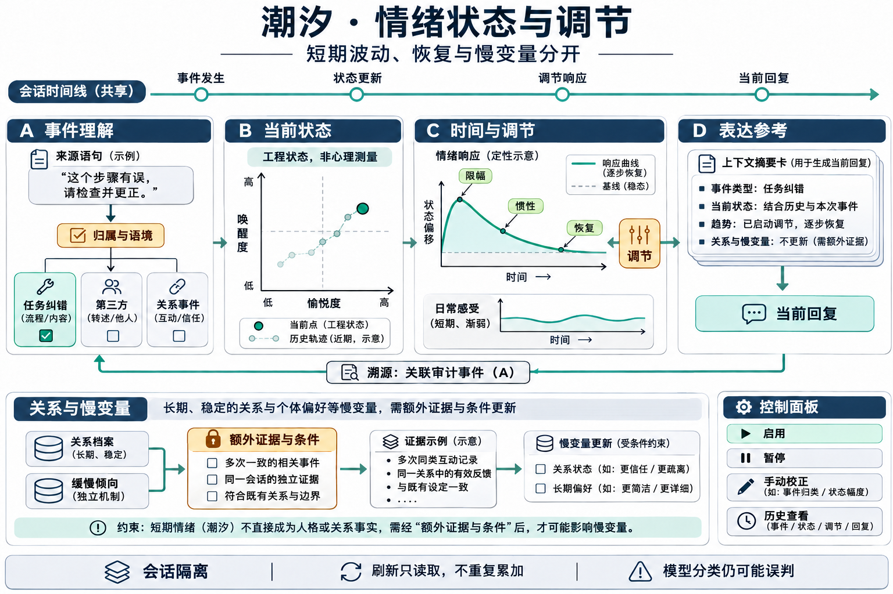
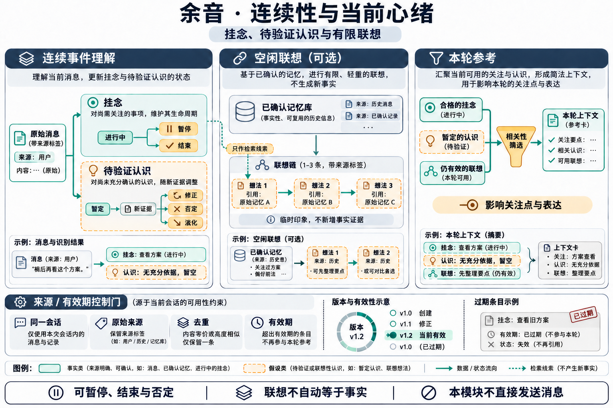
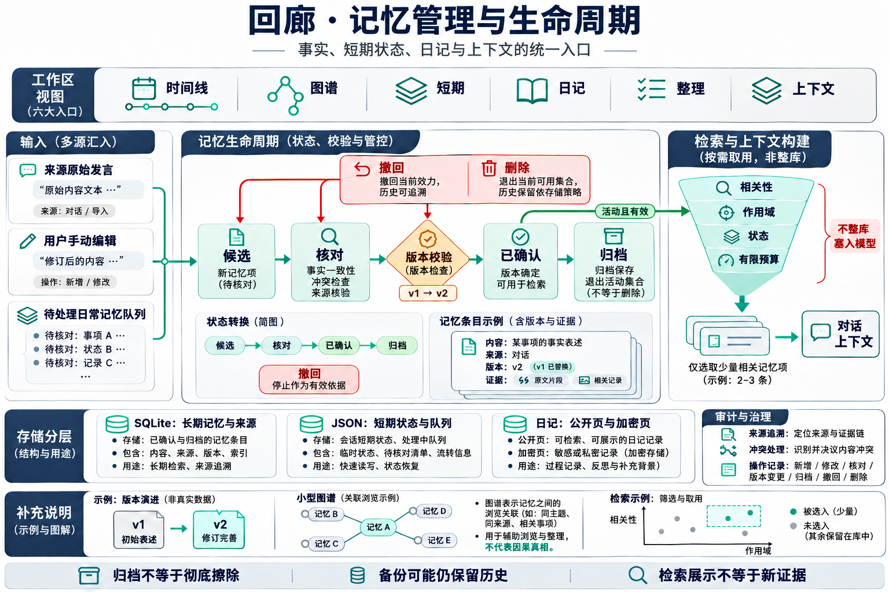
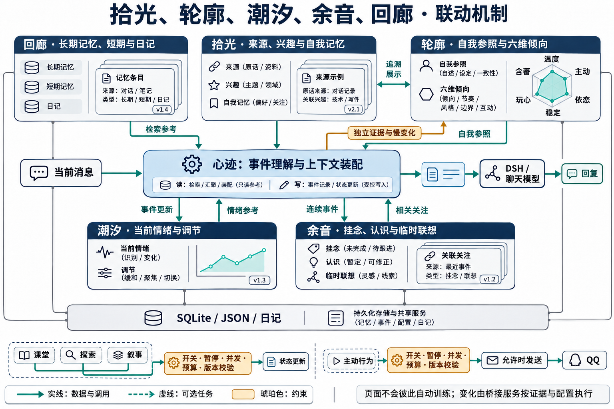

# 回响／心迹技术手册

适用版本：0.11.1。最后核对：2026-11-03。本文解释模块、状态、联动与研究依据；操作见 [用户手册](../manual/USER_GUIDE.md)，部署见 [INSTALL](../INSTALL.md)。图是逻辑机制示意，不是逐函数调用图、心理测量模型或实际部署拓扑。

## 1. 系统边界

| 部件 | 入口与职责 | 依赖与状态 |
| --- | --- | --- |
| DSH 插件 | `lib/index.js` 注册前缀；`lib/api.js` 提供页面与管理接口；`client.js` 提供宿主入口 | 宿主 Web；`bin/preview.mjs` 独立预览 |
| 控制台数据层 | `lib/core.js` 解析路径、聚合状态、调用桥接与 memvec；部分管理操作直接使用 SQLite | 数据根目录、真实数据库路径、管理令牌 |
| 心迹运行时 | `bridge/xinji-engine.mjs` 入口；`bridge/bridge-v09.js` 接入消息、编排会话和任务 | QQ / SnowLuma、DSH、桥接状态 |
| memvec | `memvec/server.py` 提供嵌入、检索、来源与事务操作 | SQLite、numpy、fastembed、本地模型缓存 |
| 前端 | `web/app.js`、`web/evidence.html`、`web/context.html` 及专门视图 | 同源管理 API，不持有桥接管理密钥 |
| 安装与验证 | `bridge/install-runtime-bundle.mjs`、`bin/doctor.mjs`、`test/` | 已知文件哈希、备份与回退、隔离夹具 |

从聊天驱动到自我驱动，工程上的变化是外部消息不再是唯一触发源：已有状态、时间和调度条件也可产生候选任务；执行仍需经过权限、暂停、预算和并发条件。模型建议不能自行绕过状态机。

## 2. 拾光：证据与来源的观察面

**输入**是原话来源、兴趣证据、自我记忆、探索内容摘录及运行状态。**输出**主要是管理视图与追溯信息；页面展示本身不是新增记忆或发起探索的理由。

`web/evidence.html` 加载 evidence context 与 associations；`taste.mjs` 管理兴趣；`self-memory.mjs` 表达带出处的事实或印象；`self-migrate.mjs` 迁移符合条件的自我记忆；`source-validity.mjs`、`source-retention.mjs` 与数据库来源表检查有效性。

探索链由 `explore.mjs` 与桥接路由配合：选题、搜索、有限候选、读取内容、模型提炼、引用验证、有界写入。`explore-fetch.mjs` 限制 HTTPS 域名；Cookie 只发给准确匹配的 API 主机，字幕请求不带 Cookie，重定向不自动跟随；每次请求有超时和体积上限。

同 URL 的探索证据重放不能继续提升强度或添加重复证据；主题数受限。不同来源／作者条件用于减少伪重复，不是事实认证。旧版历史可能已有重复证据，本版不会无提示重写全部历史。

状态主要在桥接 `state/taste.json`、`self-memory.json`、`explore.json`。探索任务串行，写入前复核暂停代次和就绪状态。多个状态文件之间不是单一数据库事务，异常恢复需结合日志与文件状态。

## 3. 轮廓：自我参照与六维倾向

`self-reference.mjs` 维护条目、队列、依据、历史与 revision；`self-temperament.mjs` 维护六维增长规则；`persona.js` 保留传统角色兼容；`openness-drift.mjs` 提供探索倾向慢通道提案。

主要输入是管理员同一私聊的有效原话。连续事件理解成功后复用结果入队，不为每条文字参考另加一次分类调用。自我、用户偏好和交互反馈分开标注；机器人受提示影响生成的台词不能天然成为独立自我证据。

整理受队列、间隔和批量上限控制；候选变化需通过版本、条目、原话 ID、逐字引用和重复检查。六维增长再检查独立经历、跨日跨度、冷却、维度数与幅度。手动编辑校验范围和 revision；存储成功才替换内存状态。

自我参照模式启用时，有效倾向来自同一份状态，避免 UI 和提示词读取不同来源。探索慢通道也更新有效状态；回滚检查当前值是否仍匹配目标提案，避免覆盖后续编辑。关联 JSON 文件仍可能部分写入成功，不能称为跨文件 ACID 事务。

管理员私聊可使用合格的私人自我参照；其他聊天只允许通用倾向投影，不携带私人经历、原话或敏感自定义标签。关闭模式不删除历史；切换应显式核对角色选择。详细机制见 [自我参照](self-reference.md)。

## 4. 潮汐：事件情绪、日常感受与调节

主要实现是 `emotion.js`、`emotion-appraisal.mjs`、`emotion-context.mjs`、`emotion-scopes.mjs` 和 `appraisal-budget.mjs`。输入包括原话、语境、已有状态与有效轮廓；输出为有界状态变化和情绪参考。

事件理解区分任务纠错、第三方、关系事件与日常感受。启用连续事件理解时优先复用判断，同一结果不应重复注入；共享结果不可用时，独立复核取决于开关与预算。

愉悦／唤醒等是工程维度，具有惯性、限幅、恢复与调节。短期感受、事件状态、关系观察与人格不是同一个累计计分器。读取视图计算展示，不重新提交事件增量；私聊与群聊使用明确作用域。

来源链展示实际采用的变化，而非模型建议变化。代码约束来源、数值和版本，不能保证语义归属永不误判。详见 [情绪架构](emotion-architecture.md) 和 [复杂情境](complex-emotion.md)。

## 5. 余音：连续性、认识与临时联想

`continuity.mjs` 管理关切、认识、事件与关系观察；`chat-clarification.mjs` 处理澄清；`idle-association.mjs`、`associations.mjs` 和 `mind-workspace.mjs` 组织有限参考。

关切可暂停或结束；认识是可支持、修正或否定的假设。来源 ID、原文指纹与证据片段参与去重；事件重放、摘要重述和联想不能变成新的独立支持。不同措辞是否指同一经历仍需模型判断。

空闲联想从同一聊天合格原始记忆出发，关切只能提供检索线索。步数、时效、冷却与相关性受限；临时印象和事实分开。新消息或来源失效可能清除参考。联想模块不直接发送 QQ；主动发送是独立路径。

衰减按有效证据时间计算，重复读取不重复扣减。修正和否定历史保留到容量清理；过期／来源失效内容不继续作为活动参考。详见 [连续性](continuity.md) 与 [会话澄清](chat-clarifications.md)。

## 6. 回廊：记忆与来源生命周期

回廊复用时间线、图谱、短期、日记、整理、上下文六个视图。实现涉及 `lib/core.js`、`lib/diary.js`、`lib/confirmation-flow.js`、`lib/candidate-auto.js`、`lib/local-memory-maintenance.js` 和 memvec。

写正文与向量更新走记忆服务；部分管理字段走受控本地 SQLite 操作。来源与当前记忆不是同一张表，来源版本支持追溯。长期、短期、候选、摘要、日记和撤回来源各有语义，不能只靠文本相似合并。

自动确认检查原话支持与现行事实关系。回执按依赖版本复用；最终在事务内重查依赖集合，防止审核后事实变化。跨聊天回执、旧来源或未完成检查不能当作通过。

检索限制作用域与状态，再使用向量相关性和保留因素选择有限参考。图谱不是因果证明。保留机制使用工程函数，例如 `R = 1 / (1 + t / S)`，其中 `t` 为距有效强化时间、`S` 为保留尺度；具体规则见 [内容保留](content-retention.md) 与实现，不能宣称复现人脑或完整 FSRS 算法。

数据库真实路径需规范化比较，C／E 两条路径可能指向同一文件。SQLite 写锁、事务回滚与 WAL 备份要求仍适用。JSON 原子替换只防止单文件半写，不保证多个文件整体提交。详见 [memvec](memvec.md)、[来源追溯](source-provenance.md)、[来源修正](source-corrections.md)。

## 7. 五者联动

### 有新消息

1. 桥接检查对象、会话、消息身份与状态，保存可引用来源。
2. 连续事件理解开启时形成判断，通过条件后更新余音与潮汐。
3. 回廊对应的服务召回有限记忆；轮廓提供允许的自我参照；余音补充相关且有效的关切或联想。
4. 装配器去重并控制参考预算，经 DSH 交给模型。投递成功不等于模型回答准确。
5. 记录回复与用量，合格证据可进入后续整理；拾光展示来源，不额外创造事实。

### 没有新消息

调度器评估空闲、冷却、关切、兴趣与预算。部分分支只记录候选；试运行关闭且相应开关允许时才执行。主动草稿生成和发送之间存在异步间隔，发送前再次复核对象、权限、暂停代次和次数。

课堂也在模型返回后检查课程 revision、权限和启用状态。停止有效写回不一定取消服务商已处理的请求或收费。

### 不允许的跨越

联想不能成为自己的新证据；情绪分数不证明人格变化；其他会话不能继承主人私人经历；旧结果不能覆盖新编辑；后台候选不能跳过发送门控；打开页面不能被当作执行后台模型任务的授权。

## 8. 配套模块索引

| 模块 | 关键文件 | 作用与边界 |
| --- | --- | --- |
| 成长课堂 | `growth-classroom.mjs` | 课程、练习与复盘；共用忙碌锁，不是基础模型训练 |
| 回应习惯 | `response-patterns.mjs`、`interaction-context.mjs` | 反馈与表达参考，与事实分层 |
| 旧表达老师 | `expression-teacher.mjs` | 自动授课关闭，历史可读 |
| 叙事 | `narrative.mjs` | 有限近期经历的版本化整理，默认关闭 |
| 主动决策 | `initiative.mjs` | 选择候选；联系、探索和共同活动各有条件 |
| 共同活动 | `shared-activities.mjs` | proposed→accepted→done 或 dropped；终态不可倒退，重复确认幂等 |
| 目标与节奏 | `goals.mjs`、`rhythm.mjs` | 调度参考，不是生理或心理测量 |
| 分享隐私 | `sharing-privacy.mjs` | 分享前检查内容与对象，仍需确定性边界 |
| 来源修正 | `source-validity.mjs`、memvec | 撤回、澄清、影响预览，校验版本与作用域 |
| 上下文效率 | `context-efficiency.mjs`、`reference-assembly.mjs`、`reference-reuse.mjs` | 限重复与大小，不能保证任意压缩无损 |
| 回合与投递 | `turn-traces.mjs`、`reply-context.mjs`、`reply-freshness.mjs` | 关联模型回合、发送、过期任务与来源 |
| 用量 | `feature-token-ledger.mjs`、`feature-model-prices.mjs`、`usage-features.mjs` | 分类与估算，不替代外部账单 |
| 梗与表达 | `meme-play.js`、`expression-guard.mjs` | 可选素材与输出约束，保留第三方归属 |

## 9. 鉴权、异常与发布边界

控制台检查回环 socket 与 Host，写请求另需控制台头与来源校验。桥接管理接口需要令牌；情绪影响统计通过控制台同源代理读取，不再作为无令牌跨域入口。memvec 使用本地令牌，不把密钥发给页面。

这不是完整的互联网多租户认证系统。反向代理、端口转发、其他本机进程与管理员权限属于额外威胁面，不能由 localhost 推导绝对安全。

探索使用域名、重定向、超时与体积约束；模型执行有自身超时。暂停代次阻止失效结果写回，但不能保证外部费用同步撤销。多状态文件更新仍有部分失败边界，应保留可检查记录。

评估脚本的私人产物写到 `<DSH_HOME>/qq-bridge/state/private-evaluation`，不写仓库 docs。打包不得包含真实快照、冻结提示、账号配置、聊天、令牌或数据库。删除当前版本数据不删除公开 Git 历史及旧 Release；历史处理是独立操作。

## 10. 测试的含义

| 层次 | 能验证 | 不能由此推断 |
| --- | --- | --- |
| 单元／状态机 | 边界、重复、转换、过期结果与错误分支 | 真实语义准确率 |
| 本地集成 | HTTP、鉴权、SQLite、来源版本与路径 | 外部平台长期稳定 |
| 浏览器 | 已覆盖页面、操作与布局场景 | 所有浏览器／宿主版本兼容 |
| 合成模拟 | 并发时序、崩溃恢复、锁冲突、失败注入 | 总体错误率、收益或费用封顶 |
| 独立人工评估 | 特定标注样本中的语义表现 | 未测领域效果或心理学有效性 |

回归使用临时数据和假模型，不发送真实 QQ，不公开真实聊天夹具。发布报告只记录本轮实际执行的结果；不把旧测试、论文指标或测试数量当作全功能无缺陷证明。

## 11. 论文与设计依据索引

以下是概念与设计参考，**不是完整复现清单或效果背书**。阈值、容量、冷却、预算主要是工程选择。原始链接核对于 2026-11-03。

| 编号 | 原始来源 | 对应思路 | 使用边界 |
| --- | --- | --- | --- |
| R1 | Park 等，2023，[Generative Agents: Interactive Simulacra of Human Behavior](https://arxiv.org/abs/2304.03442) | 经历、检索、反思与行动的组合 | 不复现其小镇实验，不继承其结论 |
| R2 | Packer 等，2023，[MemGPT: Towards LLMs as Operating Systems](https://arxiv.org/abs/2310.08560) | 有限上下文与分层记忆 | 本项目不是 MemGPT 实现 |
| R3 | Lewis 等，2020，[Retrieval-Augmented Generation for Knowledge-Intensive NLP Tasks](https://arxiv.org/abs/2005.11401) | 检索辅助生成 | 未实现论文的端到端 RAG 训练方案 |
| R4 | Madaan 等，2023，[Self-Refine: Iterative Refinement with Self-Feedback](https://arxiv.org/abs/2303.17651) | 反馈与有限迭代 | 对照课堂／复盘；自评不等于事实核验 |
| R5 | Deci 与 Ryan，2000，[The “What” and “Why” of Goal Pursuits](https://selfdeterminationtheory.org/SDT/documents/2000_DeciRyan_PIWhatWhy.pdf) | 自主、胜任与联结等动机概念 | 对照目标命名；不是给机器人赋予人类需要，不支持本项目的数值权重 |
| R6 | McAdams 与 McLean，2013，[Narrative Identity](https://doi.org/10.1177/0963721413475622) | 经历组织与叙事身份概念 | 对照叙事／自我参照；摘要不是人类身份发展，也无心理健康效果保证 |
| R7 | Pavlik 与 Anderson，2005，[Practice and Forgetting Effects on Vocabulary Memory](https://onlinelibrary.wiley.com/doi/10.1207/s15516709cog0000_14) | 练习间隔与保持的实验和模型 | 支持区分间隔经历与密集重复的思路；未复现认知模型，不支持固定 3／7／30 天参数 |
| R8 | Russell，1980，[A Circumplex Model of Affect](https://pdodds.w3.uvm.edu/research/papers/others/1980/russell1980a.pdf) | 情感维度表示 | 对照潮汐的二维表示；不支持模拟数值具有心理测量效度。出版商访问受限，未在本轮完成全文复核 |

索引核对范围包括可访问的原始论文／作者页面与出版元数据；明确标注访问受限项，不把列入索引写成全部全文审读。此处不沿用旧手册中未经核实的 FSRS 作者和 DOI 归属，也不由名词相似推导实现有效。

## 12. 插图与文档维护

六张专项图使用内置图像生成能力，提示词见 `images/prompts.json`。图中曲线为定性示意，没有实验数据含义；接口、参数与权限以同版本正文和代码为准。

当前入口固定为 README、用户手册、INSTALL、技术手册、UPGRADE、CHANGELOG、免责声明与致谢。必要的细分机制文档保留；旧版手册和过时计划不继续进入当前源码包，通过历史标签与 Releases 查阅。
