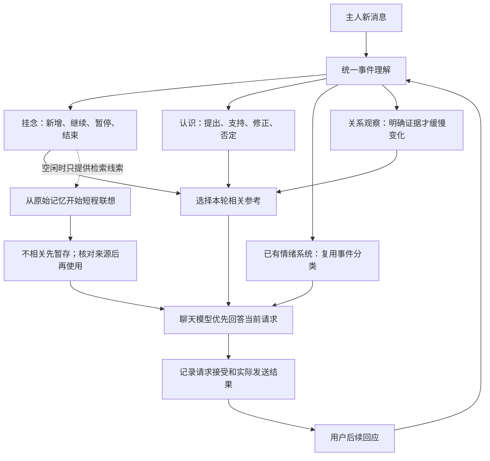

# 当前心绪：挂念、待验证认识与统一事件理解

适用版本：0.8.14。本页提供连续心绪的详细机制说明；完整操作见同版用户手册。它不是对真实意识的宣称；“心绪”指可解释、可修正的程序状态。

## 如何开启

安装同版本插件与桥接后，打开网页的“当前心绪”标签，勾选“启用连续事件理解（试验）”。默认关闭，配置为 `socialV2.continuity.enabled`。只处理当前运行模式允许的主人私聊，不跨聊天共享，也不读取其他人的连续状态。

开启后，符合条件的新文本消息先交给无工具模型整理一次事件。挂念、主观认识、关系观察使用同一结果；情绪功能开启时也复用其中的情绪分类，避免成功后再单独调用一次情绪复核。普通聊天可以完全没有状态更新，不按固定主题词表决定是否理解。

命令、敏感内容、空消息不送入这项分析；超过 2,000 字的消息不截断后猜测，使用原有聊天处理。当前流程不分析图片中的隐含事件。系统仍沿用原来的消息记录、事实提取与冲突处理，连续状态不回写事实库。

## 流程

事件理解是简短的结构化结果，不要求模型输出隐藏思考过程。事件摘要也不是经过验证的新事实。

## 当前挂念

挂念是有原话依据、尚未结束的事情。例如“明天面试，有点紧张”，可以形成“明天的面试”。它保存标题、待解决部分、来源消息、状态和期限。

- 切到代码等无关话题：保留挂念，不把它放入这轮回复参考。
- 用户主动重提：可以重新成为本轮重点。
- “暂时不想聊”：暂停。暂停后不注入，也不给空闲联想提供线索；仅用户主动重提时才应恢复。
- “已经结束了”：关闭。关闭项目不会自动重新打开。
- 到期：失效，不把长时间沉默解释成事情仍在持续。

期限由事件理解提出，代码限制在 1～168 小时；不确定时提示模型采用 72 小时。它不是精确日程提醒系统，也不承诺在指定时刻主动联系。当前挂念最多 20 条，容量满时优先移出终态项目，否则移出最早项目并记录原因。原聊天与事实记忆不因此删除。

控制台提供“暂不聊这件事”“结束这件事”，点击后立即使尚未完成的旧理解失效。历史项目仍可查来源。

## 待验证认识

认识表示“她暂时怎样理解”，例如“也许比较担心面试表现”。它不是“用户确实担心面试表现”的事实。

用户说“不是怕面试，是怕赶不上车”时，旧认识应修正或否定。修正前的内容保留在记录中，新认识重新从本次证据开始，不能继承旧认识的支持次数。点击“这个理解不对”也可以手动否定。

程序按消息 ID、原文指纹与去除标点空白后的证据片段去重：同一消息的重放、相同原文换消息 ID、同一内容在摘要或日记里重述，都不能增加该认识的证据数。只接受当前用户消息中的逐字片段；引用旧联想或其他认识不能作为新证据。

同一认识至少有三个不同日桶的原话证据，且首末跨度不少于 72 小时，才标记“多次经历支持，仍可修正”。日桶按 UTC 划分。初始生成置信度记为 0.35，满足观察条件后最高为 0.6；这是内部规则值，不是准确率。支持次数多不意味着认识就是真的，模型也可能误判哪些经历支持同一认识。

参考强度以最近一次有效新证据为起点，每七天减半；低于 0.12 时不再放入回复参考，三十天无新证据则过期。刷新页面只计算衰减，不会重复扣减。只有新的有效证据能刷新保留期限和恢复参考强度；同一句话套上不同前后文、重述同一次经历或无法确认是否为新经历，都不续期。重复原文和片段由代码拦截；不同措辞是否在重述同一经历，由模型对照已有原话判断，仍可能误判。旧版状态迁移按实际证据时间纠正期限，不沿用重复提及时错误延长的期限。

活动认识最多从有效新证据保留 30 天；最多 20 条，每条保留最近 12 个去重证据、最近三次修正及最多 256 个去重指纹。已否定内容作为历史记录保留到容量清理，并在后续理解中提醒不能复活。代码能阻止完全相同文本重复创建，换一种说法是否仍是同一认识仍依赖模型语义判断。

这些认识不会自动进入长期事实、日记、人格整理或长期情绪训练。原有的人格微调建议仍使用原来的样本、跨度、冷却和幅度约束；本版没有把“推测用户的规律”直接变成“角色的人格”。

## 关系观察与情绪

三项关系慢变量分别为信任倾向、熟悉积累、未解决张力，初始基线是 50、0、0。它们是设计参数，不是对人类感情的测量。

只有事件分类明确指向角色、置信度至少 0.85，且模型给出相匹配的明确关系证据时，才允许变化：信任或不信任单次最多变动 1 分，熟悉积累同日最多 1 分，冲突或修复使张力单次最多变动 3 分。每天最多接受两次关系变化，这是幅度限制，不是模型调用次数限制。道歉降低张力，不直接恢复全部信任。

忙碌、离开、任务纠错、用户自身难过、第三方台词和生成的联想不会直接改变关系。代码检查事件类型与关系类型配对和原话来源，但原话究竟属于哪种语义仍可能被模型误判。

关系参数只在当前消息确实谈及关系时提供为可选背景，不直接叠加到情绪分数，也不直接改写人格。每条事件会记录已有情绪系统实际采用后的变化，避免页面把“请求的变化”冒充“实际发生的变化”。

## 空闲联想如何衔接

开启本功能时，进行中的挂念可以补充空闲联想的检索线索。它不是联想的新证据：联想仍须从同一聊天的原始记忆开始，引用原始记忆 ID，使用前再次检查来源。仅有挂念、但记忆检索没有合格来源时，不会硬造联想。

原有最多两步、冷却、十分钟暂存、来源失效检查和独立主观感受开关保持有效。这里没有无限自主思考，没有增加主动发送入口。

## 页面与故障处理

“当前心绪”显示挂念、认识、原话依据、修正历史、关系观察以及事件处理和回复去向，每 15 秒刷新一次，也可手动刷新。

- 模型接受：只说明本轮请求已接受，不能证明某条参考被表达。
- 实际发送成功：说明关联回复已发出，仍不能证明使用了某条挂念。
- 投递结果未知：不能当作成功，也不补造成功记录。
- 状态保存异常：页面会提示，磁盘故障可能导致重启丢失最近状态。
- 理解失败、格式不合格或超时：本轮回退已有处理，不使用旧一轮的相关性选择。

挂念、认识和最近 60 条事件记录保存在桥接 `state/continuity.json`，包含部分原话，属于本地私有状态，不能放进公开发布附件。重启保留未到期的工作状态，但清除上一轮的“本轮相关”选择。关闭开关保留历史，不继续生成或使用参考；重新开启后等待新的合格消息。

新消息、关闭开关及手动修正会使过时的分析结果失效。正常单次分析等待上限约 8 秒，后台设置会话也计入这段等待；最多同时保留两次尚未返回的事件理解（包括本地已超时、后台尚未结束的请求），忙碌时回退原有处理。网络超时不等于服务商没有消耗 token。

## 费用

“事件理解”单独记入花费页。每条合格消息最多新增一次事件理解调用，不设置每日硬上限；成功时复用情绪分类，不再重复发起本轮独立情绪复核。事件理解失败后，原有情绪复核仍可能按自身条件调用，因此异常轮次可能同时出现两个分项。

输入包含本轮消息、最多四条近期原话片段以及有界的挂念、认识和对应原话证据（每条最多十二个），供模型区分新经历与旧事重述。不把这些历史原话当成本轮新证据。用量随文本和当前状态数量变化，不能承诺固定 token 数；账本以模型返回 usage 为准。没有有效 usage 的请求不虚构费用。

## 验证边界

隔离模拟覆盖话题切换、澄清、结束、暂停、否定、去重、跨日支持、超时、新消息抢先、设置切换、重启、来源校验、发送去向和权限隔离。浏览器使用合成内容，检查文字转义、移动端布局及开关和修正操作。

这些测试检验代码规则，不代表真实模型总能正确理解玩笑、转述、关系或长期规律。实际聊天的相关性、重复追问和自然度需要安装开启后观察。

## 情绪、性格入口与记忆确认

“情绪”和“性格”没有删除，也没有被“当前心绪”替代。入口现在始终保留；服务暂时不可用或版本不匹配时显示状态说明，情绪加载失败时可以重试。演示页未声明后端能力也不再让入口消失。

长期记忆的“待确认”与这里的“待验证认识”是不同功能。前者确认用户事实，后者保存角色的不确定理解。

确认事实时，现在把关系分为：

- 明确矛盾：需要核对原话，确实可能互斥。
- 关系尚不确定：折叠展示，不表示这些记忆中只能有一条是真的。
- 相同事实：已有记录保留，不再单独强迫选择谁真谁假。
- 可以共存或补充：保留，无需在它们之间选择。

如果候选和已有记忆都是真的，选择“确认这条，并保留全部已有记忆”。这是新的默认选项，只激活候选，不覆盖其他记录。若确需替换，界面明确标出数量，服务端也只替换明确矛盾的记录；未确定关系、相同和可共存的记录不被波及。没有明确矛盾时不提供替换选项，直接调用旧接口也不能绕过该限制。

复核尚未完成时仍需要先完成分批检查，不能把未完成显示成确认成功。保留和替换继续检查版本指纹，避免对照期间的数据更新被覆盖，并提供撤销。模型判断仍可能有误，最终以原话为准。

## v0.8.14 统一心绪页

可视化与文字视图共享状态。挂念、认识、空闲联想和主观感受集中展示，开关仍独立。情绪曲线与参数保留在“情绪”，长期事实管理仍在“长期记忆”。联想不会因页面整合而成为事实或增加权重。

详见[情绪架构](emotion-architecture.md)与[完整用户手册](../manual/USER_GUIDE-0.8.14.md)。
