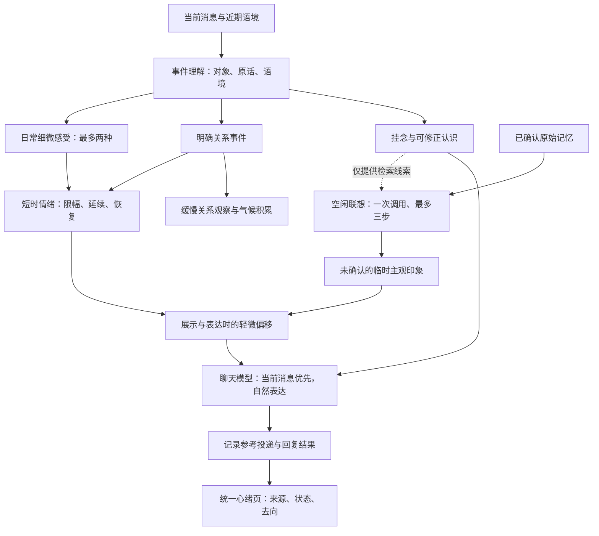

# 情绪、心绪与联想架构

适用版本：0.9.1。目标是让变化有原因、有延续、能修正，并在日常聊天中自然表现。它是一套模拟状态与表达约束，完整闭环不等于覆盖人类所有心理活动。

## 各层怎样分工

| 层 | 来自哪里 | 怎样变化 | 不应混淆的边界 |
| --- | --- | --- | --- |
| 事件分类 | 用户原话与近期语境 | 分清任务纠错、第三方、亲近、冲突和修复 | 用户难过不等于对角色生气 |
| 日常感受 | 模型在当前原话中给出依据 | 温暖、轻快、好奇、安心、牵挂、失落，每轮最多两种；按类型 12 至 30 分钟半衰期 | 不单独训练人格或关系 |
| 事件情绪 | 有效事件、已有状态、时间 | 限幅，有惯性，逐渐恢复；明确修复可缓解冲突 | 轻快不能覆盖未解决冲突 |
| 缓慢变量 | 长期有效关系样本 | 延续现有气候、关系观察与人格积累路径 | 一次普通闲聊不改写人格 |
| 挂念与认识 | 有原话的事件理解 | 相关时参考，允许澄清、否定、暂停、结束；缺新证据淡化 | 临时认识不是事实 |
| 空闲联想 | 同一聊天的已确认原始记忆 | 一次调用生成通常一到两步，有明确用途时三步，10 分钟有效，不相关时暂存 | 上一步猜测不是新证据 |
| 联想感受 | 联想附带的未确认印象 | 5 分钟减半、10 分钟失效；新主人消息清除 | 不训练长期关系或写入事实 |
| 表达 | 当前消息、事件情绪、相关参考 | 影响语气、关注点、问题意愿；可忽略不相关参考 | 不要求每轮表演情绪或索要安抚 |

日常感受的数值总偏移限制为愉悦 -0.04 至 +0.09、唤醒 -0.03 至 +0.06；联想感受另限制为愉悦 ±0.04、唤醒 +0.03。页面读取只展示，不反复累加。它们的强度和模型置信度分开处理，置信度不是现实概率。

## 界面组织

“当前心绪”集中展示来源链、挂念与认识、关系观察、空闲联想、主观印象和去向；可在可视化/文字之间切换。“情绪”继续提供数值、历史曲线与配置。“性格”保留稳定设定和长期积累。“长期记忆”管理事实、候选和自动核对。

“补充关联记忆”是原“有边界的关联”的新名称：在聊天检索时沿同一事实或来源补找旧记忆，默认一条，配置最多两条，不额外调用语言模型生成想法；可能增加聊天输入 token。它与空闲联想各有用途，继续保留。

## 用量

开启连续事件理解时，在同一输出中返回事件与日常感受，复用结果；不为温暖、好奇等分别调用。未取得共享判断且情绪模型开启时，合格的普通主人消息也可独立理解。具体 token 随提示词、历史、模型输出与推理设置变化，不承诺固定费用。空闲联想按已有频率单列，主观感受复用联想输出。心绪界面的刷新、切换视图不调用模型。

## 设计依据与验证

界面参考 [Material 语义色彩角色](https://m3.material.io/styles/color/the-color-system) 与 [Carbon 数据可视化](https://www.carbondesignsystem.com/building-blocks/data-visualization/overview) 的信息层次思路，使用原生 HTML/CSS/SVG 实现。颜色之外保留文字状态、可选卡片与键盘操作；关系连线只表示真实选入参考，不编造因果。

离线验证覆盖普通交流、混合感受、严格的负面关系门槛、重复输入、刷新不累加、恢复、修复与冲突保留。合成对话模型试跑只能说明这些样例的表现，不等于长期语义准确率；复杂反讽、角色扮演和跨轮指代仍需观察。

## 日常感受、性格联动与近期便签

日常 feelings 的置信度独立于关系主分类；主分类不确定时，有确切原话依据的轻微好奇仍可成立。每项可提供简短原因，来源编号与时间由程序附加。稳定性格底色（最多八维，不读取瞬时 current）作为感受判断的风格背景，不是用户意图或攻击的证据。

旧感受作为后续事件理解的背景，不重新计票；规范化相同的感受原话在保留的去重窗口内不续期、不增强。温暖30分钟、轻快15分钟、好奇12分钟、安心20分钟、牵挂25分钟、失落20分钟减半。上限沿用原有小幅偏移。用户明确解决或否定触发事件时，模型可以用当前原话提出 settle，将对应感受收束至原来的15%；没有新证据时自然淡化。

感受存在时提高本轮情绪参考优先级，但仍受字符与条数预算限制。平静标签不会掩盖好奇等细微感受；界面突出具体感受，允许查看原因。模型共享理解成功时不增加独立情绪调用；失败或未开启共享理解、但开启情绪模型时，符合条件的主人消息最多补一次独立调用（1000字符限制仍保留）。模型结果无效时继续保守处理，不声称必然更自然。

自动近期便签复用长期记忆提取调用。主体、原话、置信度与语气均须验证，保留1至24小时，从消息原始时间计时，不从处理时间续期。相同原话不续期；明确完成可结束。它们不能自动确认长期事实、修改性格或改变关系。个人信息面板直接读取同一聊天内已确认、有效、未被替代的长期记录，不复制回轻量记忆。

这次保留心光中有限关注、思想延续、经历反馈的思路，未加入虚构身体状态、随机无视用户或将模拟课堂/自述当成真实证据。长期情绪到性格底色的原有开关、样本门槛和冷却仍保留；新增细微感受不会直接进入人格训练。
