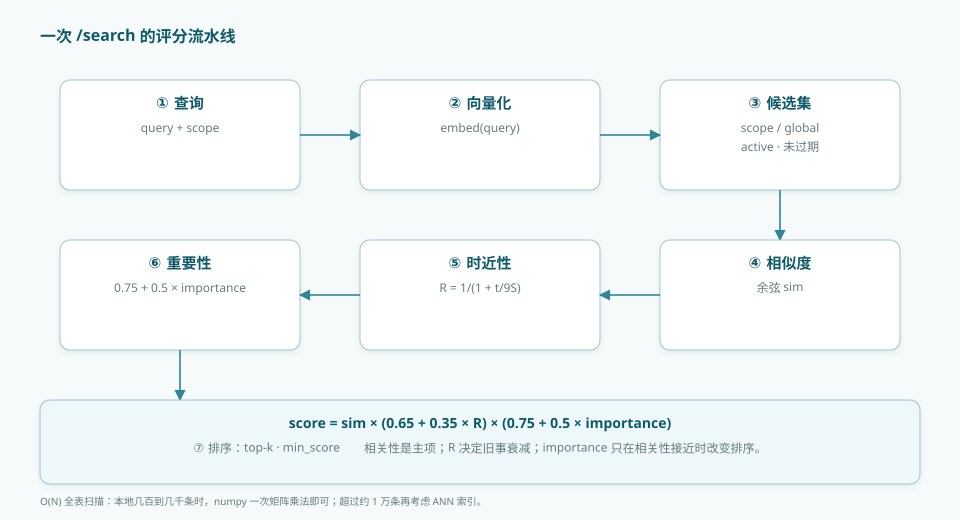
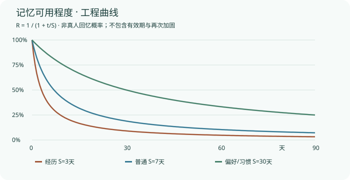

# memvec 技术说明

版本 0.7.2-ctx · 2026-10-28

memvec 是「可塑性记忆」的本地记忆服务：一个只监听 `127.0.0.1:9881` 的 Python 进程，用 SQLite 存记忆，用本地向量模型做语义检索，用幂律遗忘曲线决定“还记得多牢”。

它不生成记忆，也不替角色说话；它负责四件事：**存**、**找**、**忘**、**留痕**。

## 一、技术栈

| 层 | 选型 | 说明 |
|---|---|---|
| 语言 | Python 3.10+ | 只用标准库 + numpy + fastembed |
| 存储 | SQLite（stdlib `sqlite3`） | 单文件 `memories.db`，向量以 BLOB 存 |
| 向量 | `BAAI/bge-small-zh-v1.5` | 中文小模型，512 维，4 层，最大 512 token，MIT |
| 推理 | fastembed + ONNX Runtime | CPU 即可，首次下载模型后离线 |
| 数值 | numpy | 向量归一化、矩阵点积 |
| 服务 | `http.server.ThreadingHTTPServer` | 仅回环，JSON 接口 |
| 并发 | `threading.Lock` | 所有写操作和检索串行化 |

选型原则是“单机、可离线、零外部依赖”：没有 Redis、没有向量数据库、没有云 API。整个记忆库就是一个 SQLite 文件，复制走就能备份。


## 二、数据模型

### memories：长期记忆

| 字段 | 作用 |
|---|---|
| `id` / `text` / `tags` / `scope` | 主键、正文、标签、所属聊天（`private:ID` / `group:ID` / `global`） |
| `embedding` | 512 维 float32，归一化后存 BLOB |
| `importance` | 0–1，参与检索排序 |
| `strength_days` | 记忆强度 S，决定遗忘速度 |
| `created_at` / `last_access` / `last_reinforced` | 入库、最近访问、最近强化 |
| `status` | `active` / `candidate` / `superseded` / `deleted` / `archived` / `completed` |
| `tier` | `normal` / `core` / `task`；core 与 task 不自然衰减 |
| `fact_key` / `subject_id` | 同一主体的同一方面，用于去重和冲突判断 |
| `source_id` / `source_text` / `source_time` | 来源消息与原始表述，便于回查 |
| `relation` / `related_id` / `superseded_by` | 与旧记忆的关系：等价、替换、冲突、不确定 |
| `expires_at` | 计划/经历的过期时间；0 表示不过期 |

### 其他表

- `memory_operations`：确认操作的审计快照，支持整批撤销。
- `messages`：原文层，逐条消息（谁、何时、说了什么），每聊天保留最近 5000 条。
- `session_summaries`：摘要层，带 `period_start/period_end/covered_ids/value/kind`；`value=0` 是“仅覆盖”，`kind=low` 是低信息量。

## 三、写入：一条记忆怎么进来

`POST /add` 的主流程：

1. **校验**：正文 1–500 字，scope 必须是 `private:ID` / `group:ID`；importance、confidence 在 0–1。
2. **向量化**：`embed(text)` 得到 512 维向量并归一化。
3. **去重**：同 scope、同主体、同正文（或同 `source_id + fact_key`）视为重复；同一个人再次明确表达时，强度 ×1.4，上限 365 天，且 3 天内不重复强化。
4. **重复事件合并**：正文去掉日期后相同、只有日期不同的事件（如“10月1日去广场玩了”“10月2日去广场玩了”）会并入同一条，日期合成“2026年10月1日、10月2日”。这样每天重复的事不会堆成几十条。
5. **关系判断**：如果调用方带了语义关系（`equivalent` / `replace` / `conflict` / `uncertain`），按规则合并、替换或标为候选；替换会把旧记忆置为 `superseded`。
6. **分层**：明确要求长期记住的标 `core`；明确待办标 `task`；其余 `normal`。`normal` 的计划/经历 7 天后过期。
7. **落库**：写入 memories，初始强度按 scope 取 180 天（管理员私聊）或 2 天（群聊/其他人）。

### 重复事件合并

写入时先找同 scope、同主体、正文（去掉日期后）相同的活跃记忆；命中就把日期并进去，不新增行。服务启动 8 秒后、之后每 6 小时会跑一次 `POST /consolidate`，把历史上已经堆出来的同正文事件合并成一条，旧行标 `superseded`，`relation='merge'`，可追溯。

检索时还会做一次结果去重：同正文只保留最高分的一条，向量相似度 ≥0.95 的近似结果也不会重复占 top-k。这样记忆多时不会因为同一件事反复出现而挤掉真正相关的内容，也能减少无谓的字符和延迟。

## 四、检索：相关性 × 时近性 × 重要性

`POST /search` 的评分：

```
R = 1 / (1 + t / (9S))                 # 幂律遗忘概率，t 为距 last_access 的天数
score = sim × (0.65 + 0.35R) × (0.75 + 0.5×importance) × (1 + 0.35×lexical + 0.15×phrase)
```

- `sim`：查询向量与记忆向量的余弦相似度（都归一化，点积即余弦）。
- `R`：时近性；`S` 越大忘得越慢。`core` / `task` 直接取 `R=1`。
- `importance`：0–1，只做 0.75–1.25 的温和放大，避免“重要但无关”的旧事压过当前话题。
- `lexical`：中文二元组 + 英文词的关键词重合率；`phrase` 表示整段查询原文出现在记忆里。名字、地名、专有名词靠它兜底，避免向量把“同主题但不同人”排前面。
- global 的旧记忆保留可召回，但在非 global 查询里乘 0.88，不压过当前聊天的直接证据。



检索范围固定为“当前聊天 + global 的 active、未过期记忆”，返回里带 `retrieval` 因子（similarity、retention、importanceFactor、score），方便控制台解释“为什么召回这条”。

### 为什么用全表扫描

当前实现是“把候选向量堆成矩阵，一次 `mat @ q`”。复杂度 O(N)，但本地记忆量通常在几百到几千条，numpy 一次矩阵乘法是毫秒级；省掉了 ANN 索引的构建、更新和一致性维护。**如果单库超过约 1 万条，再考虑 HNSW/FAISS**，这是明确的扩展点，不是当前瓶颈。

## 五、遗忘：为什么是幂律

指数衰减在长尾上掉得太快，和真实回忆不符；幂律 `R = (1 + t/(9S))^(-1)` 更接近长期记忆的实证曲线，也是 FSRS 一类调度器的同族形式。



- 管理员私聊：S=180 天，默认忘得慢。
- 群聊/非管理员私聊：S=2 天，默认忘得快。
- 强度上限 365 天；同一人再次明确表达才强化，查询本身不强化。
- 衰减任务：`R < 0.12`、存活超过 14 天、importance < 0.8 的 `normal` 记忆会被归档（`archived`），不是物理删除。

## 六、冲突与撤销

- 候选记忆（`candidate`）不会自动生效，需要确认。
- 同一 `fact_key` 的新事实会让旧事实 `superseded`；矛盾但无法判断时保留候选，交给人处理。
- 确认是事务操作：受影响行的前后指纹写入 `memory_operations`，撤销时逐行校验“有没有被后续修改”，有冲突就整批拒绝（HTTP 409）。

## 七、接口

| 方法 | 路径 | 用途 |
|---|---|---|
| POST | `/add` | 新增/合并一条记忆 |
| POST | `/search` | 语义检索 |
| POST | `/related` | 同主体相关记忆（整理时做冲突判断） |
| POST | `/priority` | core/task 优先注入 |
| POST | `/confirm`、`/confirm/undo` | 事务确认与撤销 |
| POST | `/manage` | 人话命令：查看/忘记/纠正/完成待办 |
| POST | `/decay` | 衰减与归档 |
| POST | `/consolidate` | 合并同正文、不同日期的重复事件（可传 `scope` 或 `dry`） |
| POST | `/message`、`/messages` | 原文层写入/读取 |
| POST | `/summary`、`/summaries`、`/summary/delete` | 摘要层读写 |
| POST | `/context`、`/context/stats` | 注入用的上下文块与统计 |
| GET | `/stats` | 总量、scope 分布、能力声明 |

## 八、性能与边界

- 写入和检索共用一把锁，单进程串行；本地单用户场景足够，别把它当高并发服务。
- **线程**：默认 `MEMVEC_THREADS=4`，同时限制 OMP/MKL/BLAS 线程，避免后台服务一次抽走所有核；单机想快可设 8，想更省设 2。
- **向量矩阵缓存**：按 scope 缓存 active 记忆的向量矩阵 30 秒，写入/确认/删除/衰减/归并时主动失效；省掉每次检索的 `np.stack` 和 BLOB 读取。
- **实测**（47 条、20 核）：单次检索墙钟约 33ms、CPU 约 39ms；20 次连续检索平均占总 CPU 约 5.8%，空闲 0%；内存约 195MB。
- **规模**：几十到几千条用精确扫描即可；5k 条矩阵约 10MB，扫描仍在毫秒级。`ANN_MIN` 默认 20000，超过这个量才需要考虑 HNSW/FAISS；当前 `/stats` 会报告 `index: exact-cache` 和 `ann_threshold`。
- 向量存在 SQLite BLOB 里，库文件会随记忆量增长；备份就是复制 `memories.db`。
- 模型首次启动下载到 `hfcache/`，之后离线加载；缓存路径可用 `MEMVEC_CACHE_PATH` 指定。
- 只监听回环地址，没有鉴权；它假设“能连 127.0.0.1 的就是本机用户”。不要把端口转发到公网。
- 没有做多进程写入协调；同一数据库只应有一个 memvec 实例。

## 九、设计取舍

- **SQLite 而不是向量库**：单文件、零运维、易备份；代价是全表扫描和单写锁。
- **bge-small-zh 而不是大模型**：512 维、CPU 可跑、中文效果够用；代价是语义精度不如更大模型。
- **幂律而不是指数**：更贴近长期遗忘；代价是参数（9S、上限、强化倍率）需要按使用习惯调。
- **importance 温和放大而不是硬加权**：相关性仍是主项；代价是 importance 只在“相关性接近”时改变排序。
- **保留原文和摘要两层**：摘要保大意，原文保细节；代价是存储和摘要生成的 token。

## 参考文献

1. Ebbinghaus, H. (1885). *Über das Gedächtnis: Untersuchungen zur experimentellen Psychologie*. Duncker & Humblot.
2. Wixted, J. T., & Ebbesen, E. B. (1991). On the form of forgetting. *Psychological Science*, 2(6), 409–415. https://doi.org/10.1111/j.1467-9280.1991.tb00175.x
3. Anderson, J. R., & Schooler, L. J. (1991). Reflections of the environment in memory. *Psychological Science*, 2(6), 396–408. https://doi.org/10.1111/j.1467-9280.1991.tb00174.x
4. Cepeda, N. J., Pashler, H., Vul, E., Wixted, J. T., & Rohrer, D. (2006). Distributed practice in verbal recall tasks: A review and quantitative synthesis. *Psychological Bulletin*, 132(3), 354–380. https://doi.org/10.1037/0033-2909.132.3.354
5. Ye, J., Su, J., & Cao, Y. (2022). A Stochastic Shortest Path Algorithm for Optimizing Spaced Repetition Scheduling. *Proceedings of the 28th ACM SIGKDD Conference on Knowledge Discovery and Data Mining (KDD '22)*, 4381–4390. https://doi.org/10.1145/3534678.3539081
6. Xiao, S., Liu, Z., Zhang, P., & Muennighoff, N. (2023). C-Pack: Packed Resources For General Chinese Embeddings. arXiv:2309.07597. https://arxiv.org/abs/2309.07597
7. BAAI. *bge-small-zh-v1.5* model card. https://huggingface.co/BAAI/bge-small-zh-v1.5
8. Qdrant. *FastEmbed: Fast and Lightweight Embedding Generation*. https://github.com/qdrant/fastembed
9. Hipp, D. R. *SQLite*. https://sqlite.org/docs.html
10. Park, J. S., O'Brien, J. C., Cai, C. J., Morris, M. R., Liang, P., & Bernstein, M. S. (2023). Generative Agents: Interactive Simulacra of Human Behavior. *UIST '23*. arXiv:2304.03442. https://arxiv.org/abs/2304.03442
11. Packer, C., Wooders, S., Lin, K., Fang, V., Patil, S. G., Stoica, I., & Gonzalez, J. E. (2023). MemGPT: Towards LLMs as Operating Systems. arXiv:2310.08560. https://arxiv.org/abs/2310.08560
12. Manning, C. D., Raghavan, P., & Schütze, H. (2008). *Introduction to Information Retrieval*. Cambridge University Press. https://nlp.stanford.edu/IR-book/

---

本说明对应 memvec 0.7.2-ctx。实现以 `memvec/server.py` 为准；使用手册见《可塑性记忆-使用手册-0.7.2.pdf》。
