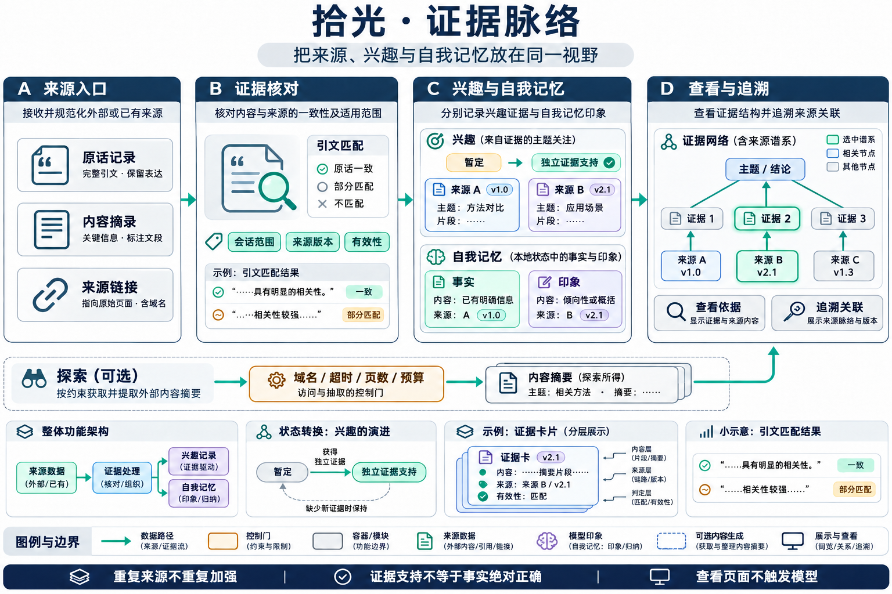
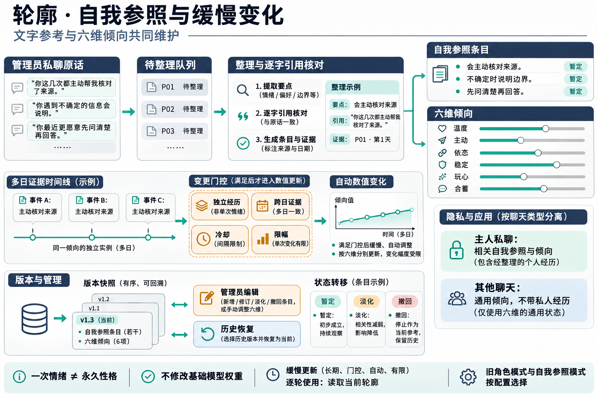
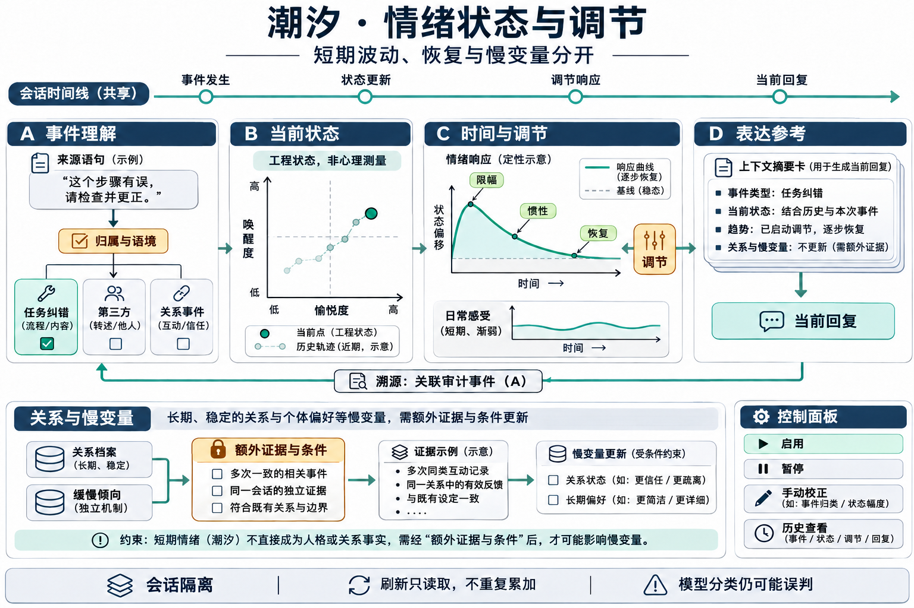
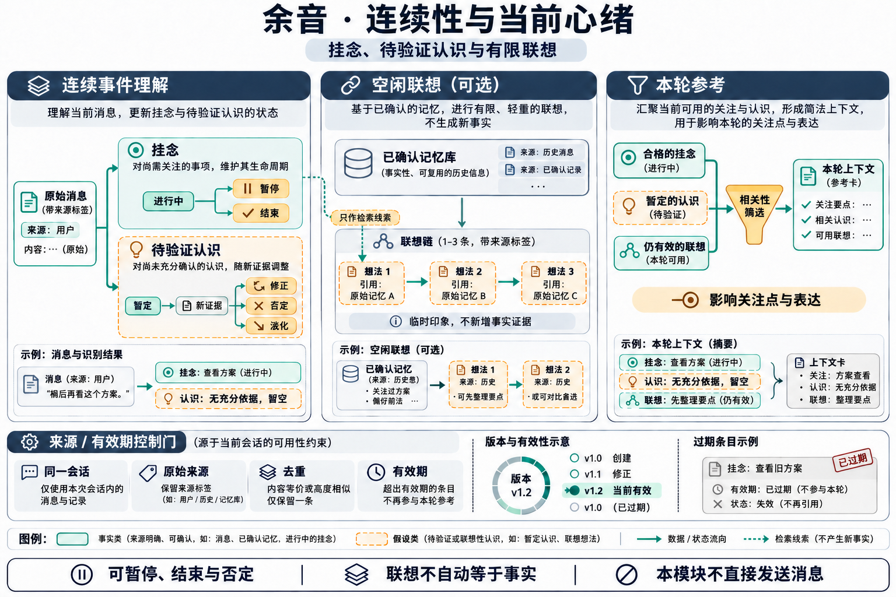
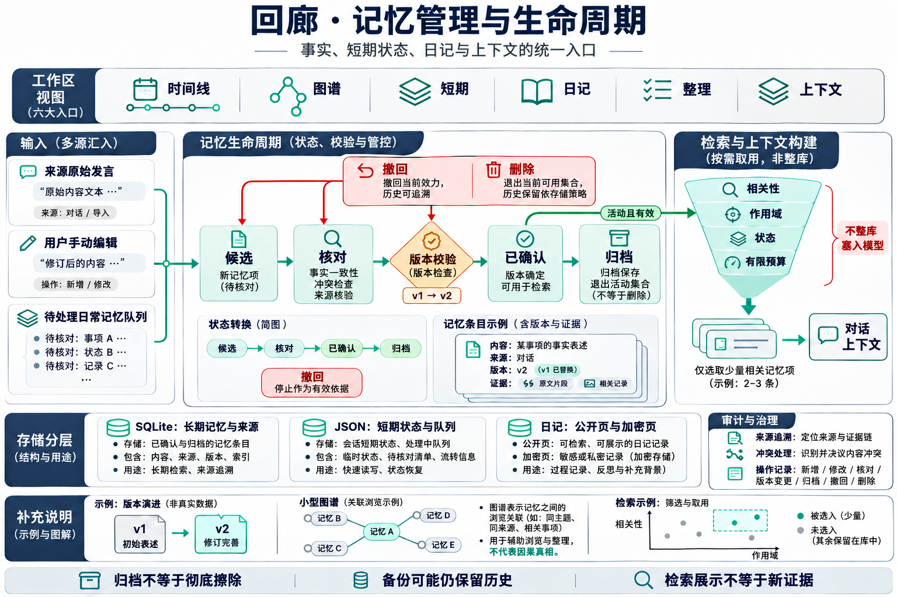

# 回响／心迹用户手册

适用版本：0.11.2。最后核对：2026-11-03。面向使用者；安装、环境变量、运行时升级见 [INSTALL](../INSTALL.md)，模块实现、联动与论文索引见 [技术手册](../docs/TECHNICAL_MANUAL.md)。

## 1. 它是什么，和聊天机器人有什么不同？

回响是管理界面，心迹是承接对话、理解事件和执行后台任务的桥接运行时，memvec 负责本地记忆存储与检索。聊天模型仍由 DSH 调度。

传统聊天流程主要是“你发消息，它检索并回答”。本项目进一步保存来源、关切、暂定认识、情绪、自我参照和任务状态；在相应功能启用后，没有新消息时也可以进行有限联想、探索内容、整理经历或考虑主动联系。后台产生候选、执行任务、向 QQ 发出消息是不同阶段，分别受配置和条件控制。

这不意味着它有人的意识、真实情感或独立意志；“心绪”“成长”“自我驱动”是交互与软件机制的名称。学习主要改变本地状态、参考和策略，不训练基础模型权重。

## 2. 第一次打开，先看什么？

1. 打开 DSH 中的回响入口，或本机 `http://127.0.0.1:3080/dsh-feiyu-memory/`。端口以你的 DSH 配置为准。
2. 看总览中的连接状态。页面可打开，不代表桥接、记忆服务、QQ 和模型都已连接。
3. 确认当前聊天范围。主人私聊、其他私聊与群聊不是同一个记忆作用域。
4. 在账本查看模型和计费配置；先关闭不需要的后台任务，再逐项启用。
5. 用不含隐私的普通对话检查来源、记忆和回复是否对应，再投入日常使用。

升级会保留已有配置。以下“默认”指代码在没有对应配置时的行为，不表示你这台电脑当前的开关状态。安装预设也可能设置开关；必须以页面和实际配置为准。

## 3. 九个入口分别用来做什么？

| 入口 | 你可以做什么 | 先注意什么 |
| --- | --- | --- |
| 总览 | 看连接、数据数量与运行概况 | 数量多不等于理解准确 |
| 拾光 | 看来源脉络、兴趣证据、自我记忆及相关状态 | 展示的“印象”不等于已证实事实 |
| 轮廓 | 看与编辑倾向、自我参照、依据和历史版本 | 一次心情变化不应直接变成人格结论 |
| 潮汐 | 看当前情绪、变化、调节和历史 | 分数是工程参数，不是心理测量 |
| 余音 | 看挂念、待验证认识、空闲联想及其去向 | 可以否定、暂停和结束，不必接受模型解释 |
| 年轮 | 管理成长课堂、课程、练习和复盘 | 执行学习任务可能调用模型 |
| 回廊 | 时间线、图谱、短期、日记、整理、上下文 | 管理本地资料，操作前确认聊天范围 |
| 梗库 | 浏览可用梗与使用参考 | 有梗库不代表每轮必须玩梗 |
| 账本 | 查看用量、功能分类、模型价格与推理档位 | 估算费用要与服务商账单核对 |

## 4. 拾光：它为什么有这条兴趣或印象？

拾光把来源、兴趣证据、自我记忆和相关脉络集中展示。先查看条目的出处、摘录和时间，再判断它是否被准确理解。不要仅凭图中节点相连，就认为两个事实之间存在因果关系。

探索是可选的内容获取任务，不是“拾光”整页的同义词。它尝试读取内容、提炼有原文支持的印象，然后记录来源。遇到没有字幕、访问受限、超时或证据不匹配，可能没有可保存的结果。

同一来源重复访问不会在本版中反复提高探索兴趣强度。不同来源提供支持也不保证结论正确；模型仍可能误解语境。“暂定”和“确认”描述内部证据规则，不是现实真实性认证。

**会偷偷上网吗？** 启用定时探索，或允许主动决策实际执行探索后，可能访问配置支持的公开内容服务。手动点击探索也会联网。关闭定时探索不等于禁止主动决策中的探索分支。

**怎么关？** 同时关闭探索定时开关与主动决策中的“允许探索”；如果不需要任何主动任务，关闭主动决策。工程配置分别为 `socialV2.explore.enabled=false`、`socialV2.initiative.allowExplore=false`。手动探索需要你另行触发，仍受运行状态与预算检查约束。

## 5. 轮廓：它会越来越像某个人吗？

轮廓包含六维倾向和可成长的自我参照。启用自我参照时，相关用户原话经队列整理，形成带依据的条目；当前状态、变化历史和手动编辑入口帮助你检查变化从哪里来。

六维为温度、主动、依恋倾向、情绪稳定、玩心和表达含蓄程度。0–100 是倾向值，不是好坏评分；高分也不是要求模型每轮表演某种性格。普通对话、基础指令和当前任务仍影响最终回答。

**会把我的爱好变成它自己的爱好吗？** 设计上区分用户偏好、交互反馈和自我条目，但语义分类仍可能误判。发现归属不对，应撤回条目并检查引用，不要靠重复强调错误结论来“训练”。

**会自动改变性格吗？** 启用相应成长机制后可能发生有限变化，受独立经历、跨日证据、冷却和幅度限制。探索倾向还有单独的慢通道。自动变化不保证自然、合理或符合你的预期。

**怎么修正？** 查看依据 → 编辑或撤回错误条目 → 必要时恢复可用的历史版本 → 继续观察。恢复自我参照版本不等于恢复整个数据库，不能替代备份。

**怎么关？** 关闭自我参照可停止使用该模式；同时核对是否回到了旧角色模式，不能把关闭开关理解为删除人格配置。若要保留当前轮廓但停止新学习，还应关闭其上游连续事件理解；探索慢通道可设 `socialV2.opennessDrift.enabled=false`。详细配置见工程文档。

## 6. 潮汐：它为什么突然不高兴？

潮汐展示事件引起的情绪状态、日常感受、调节和时间变化。系统尝试区分对角色的关系事件、任务纠错、第三方内容和用户自身情绪。例如“这道题算错了”不应自动解释成关系冲突。

**会不会误判？** 会。引用别人说的话、反讽、简短回复和多话题消息都可能让模型分错归属。先查看来源与变化记录，再做校正。曲线能解释程序记录了什么，不能证明模型理解了真实意图。

**为什么数值自己变化？** 短期状态有恢复和衰减；不同状态的时效不同。刷新页面只应读取当前结果，不应重复叠加同一次事件。情绪恢复也不等于未解决的关切已结束。

**怎么关？** 在潮汐的情绪设置关闭情绪功能；不需要额外模型判断时，还要关闭情绪模型复核。余音中的联想主观感受有独立开关，需分别处理。关闭界面或浏览器标签页不关闭后台桥接。

## 7. 余音：挂念、认识和联想有什么区别？

| 内容 | 含义 | 不满意时怎么做 |
| --- | --- | --- |
| 挂念 | 尚未结束、未来可能相关的一件事 | 暂停、结束；检查原话归属 |
| 待验证认识 | 对经历模式的暂定解释 | 标记理解不对、修正或否定 |
| 空闲联想 | 从同一聊天的合格原始记忆生成的短暂联系 | 关闭空闲联想；检查它引用的记忆 |
| 主观感受 | 联想附带的临时印象 | 单独关闭联想感受，不必关闭全部记忆 |
| 关系观察 | 受限的长期关系参数 | 查看事件依据，不能当作对人的诊断 |

**它会一直在后台思考吗？** 不会无限循环自主思考。空闲联想有调度、条件、冷却、有限步数和失效时间。没有合格来源时不应凭挂念编造新事实。

**它会把猜测写成事实吗？** 待验证认识与联想不是长期事实的自动确认依据。代码有来源与状态校验，但不能保证模型语义永远正确；发现错误请否定对应认识，必要时修正底层来源。

**怎么关？** 关闭连续事件理解、空闲联想、联想主观感受中不需要的项目。这些开关分别对应不同功能；只关闭其中一项不表示其余项停止。

## 8. 回廊：记忆怎么保存、修改和删除？

回廊有六个子页。时间线查看长期记忆；图谱查看关联；短期查看轻量状态；日记查看按日内容；整理处理候选与维护；上下文检查本轮参考如何组成。

### 8.1 一条候选记忆怎样成为已确认记忆？

先选对聊天范围，再查看原话、提取内容与已有事实。检查它是否新增了原文没有的信息、是否与旧事实冲突、是否遗漏了时间条件。自动核对失败或暂缓时，未完成的部分不能当作通过；可以人工检查后继续处理。

**为什么核对又花钱？** 某些事实关系与原话支持检查会调用模型。有效回执可以复用；原话、候选正文、旧事实或相关集合变化后需要重新验证。阅读一条记忆与点击“模型核对”是不同操作。

### 8.2 它会忘记吗？

会发生参考强度衰减、状态过期或归档。保留规则结合时间、重要性和有效独立经历；不是每次打开或召回就加固。归档通常表示退出活动集合，不等于从磁盘抹除全部历史。

### 8.3 删除后是否彻底消失？

不能作这种保证。当前记录、来源、关联、审计和备份有各自的保留规则。删除或撤回当前条目，也不保证第三方模型服务、QQ、历史备份或已发布附件中的副本被删除。完整清理要按数据类型检查，先备份需要保留的内容。

### 8.4 日记私密吗？

项目支持公开日记与加密私人库，但其他状态文件并非全部加密。“公开”是本项目中日记类型的名字，不表示默认发布到互联网。写日记使用外部模型时，相关输入可能传给模型服务；加密落盘不等于生成过程离线。

## 9. 年轮：课程、练习和复盘怎样使用？

启用课堂后建立课程，检查课程内容与权限，再启动练习、答题或复盘。课堂保存任务和历史，模型生成的答案与评分仍需人工判断。它不是基础模型微调，也不保证学完后在所有聊天中稳定掌握技能。

当前课堂的启动、作业答题和自测共用忙碌锁，避免同时发起多轮。任务进行中关闭课堂、编辑课程、改变权限或暂停后，已失效的结果不能继续提交为新学习结果。外部模型已经开始的调用可能仍计费。

**怎么关？** 关闭年轮中的课堂总开关。删除课程前先确认是否要保留练习历史；停止当前后台进程不等于卸载课堂数据。

## 10. 它会主动给我发消息吗？怎样完全停下来？

有主动联系能力，但“在后台算出想联系”与“真正发出消息”不同。主动决策默认启用候选计算、默认 `dryRun=true`；联系默认 `allowContact=false`，发送还要求 `contactSend=true`。升级后的配置可能不同。

真正发送还受运行模式、就绪状态、暂停、对象、空闲时间、冷却和次数约束。手动测试发送也会发真实消息，不要当作无副作用的预览。

共同活动使用明确的回复：`一起看：接受`、`一起看：完成`、`一起看：取消`。只有管理员对应私聊、存在有效活动、状态转换允许时才处理。普通“可以”“不可以”“还没看完”不会被本版当作确认指令。

| 想要的效果 | 应采取的操作 | 还会发生什么 |
| --- | --- | --- |
| 不主动私聊，但继续记忆 | 关闭允许联系与实际发送 | 对收到的消息仍可正常回应 |
| 不自主探索 | 关闭定时探索和主动决策中的探索 | 手动触发是另一个入口 |
| 只观察主动决策 | 保持试运行 `dryRun=true` | 可记录候选，不代表整个桥接无其他后台任务 |
| 暂停 AI 活动 | 使用桥接暂停，并核对状态 | 已在外部执行的请求可能仍产生费用；不是数据清除 |
| 确保桥接不再运行 | 停止桥接及其自动重启守护进程 | DSH 自身、其他插件和模型会话可能仍在运行 |
| 停止整个相关系统 | 分别停止桥接、记忆服务及不需要的宿主进程 | 数据保留；重启后按配置恢复 |

仅禁用 DSH 的回响页面插件，不能保证独立运行的心迹桥接也停止。若需要彻底停用，请按工程文档核对进程与守护程序。

## 11. 多少钱？会不会不聊天也花钱？

插件本身以 MIT 许可证提供，不内置统一订阅售价。DSH、QQ 接入、模型服务、网络与硬件分别使用你自己的环境；第三方是否收费应以其条款和账单为准。

| 操作 | 通常是否产生额外聊天模型调用 |
| --- | --- |
| 浏览页面、切换页签、查看已有记录 | 不因单纯查看发起聊天模型调用 |
| 本地向量检索、SQLite 查询 | 通常没有聊天模型 API 费用，仍占本机资源 |
| 正常对话 | 使用配置的聊天模型；附带参考可能增加输入 token |
| 事件理解、事实核对、性格整理、课堂 | 相应模型功能执行时可能产生调用 |
| 空闲联想、探索提炼、叙事、日记、主动草稿 | 启用并满足条件时，即使你没发新消息也可能计费 |
| 首次向量模型下载 | 需要网络与存储；不是每次检索都付聊天 token 费 |

费用近似为 `(未命中缓存输入×输入单价 + 缓存输入×缓存单价 + 输出×输出单价) / 单价计量单位`。实际还取决于服务商的推理、缓存和其他计费规则。**没有脱离模型、用量和单价的固定“每天多少钱”。**

账本是估算与排查工具，不是支付账单。部分探索／叙事预算路径使用内部参考价格计算，与自定义模型实际价格可能不同；预算阈值也可能在一轮完成后才反映用量，不能当作服务商硬封顶。需要严格控制支出时，应同时在模型服务商处设置可用的消费限制。

代码回退值中，定时探索默认关闭，每日最多 2 轮、每轮最多 2 个候选页面，探索估算日阈值为 0.05；叙事默认关闭，估算日阈值为 0.1。这些是内部计价口径下的数值，不是实际每日收费承诺，也不是所有任务合计上限。

省费用的顺序：关闭不用的主动发送和后台任务 → 降低必要任务频率 → 查看按功能分类的实际用量 → 选择适合的推理档位 → 与服务商账单核对。不要只因为数据库条数多就清空数据，系统不是每轮整库发送。

## 12. 数据在哪里？E 盘迁移以后怎么找？

默认数据根目录是用户主目录下的 `.dsh`，可以通过 `DSH_HOME` 改变。代码目录和数据目录不是同一个概念；插件升级不应该用发布包覆盖个人状态。

| 内容 | 默认相对于数据根目录的位置 |
| --- | --- |
| 长期记忆、来源与关联 | `memvec/memories.db` |
| 心迹配置 | `qq-bridge/config.json` |
| 短期、连续性、课堂、自我参照与用量 | `qq-bridge/state/` 下的 JSON / JSONL |
| 情绪、经历、标签及私人库等 | `feiyu-memory-console/` |
| 日记 | 根目录下的 `whale-diary*.md` 等文件，部分路径可配置 |
| 向量模型缓存 | 通常在记忆数据库旁的 `hfcache/` |

一种迁移布局是：数据根目录 `E:\dsh-home`，插件代码 `E:\dsh\plugin\feiyu-memory-console`，实际控制台数据 `E:\dsh\data\feiyu-memory-console`。若根目录下相应位置是指向后者的目录联接，两条路径可能访问同一份文件。该布局只是示例，不是安装后自动采用的固定路径。

发现旧 C 盘路径不代表程序一定在用旧数据；也不能只看文件名就认定是同一数据库。应核对运行进程的环境变量、数据库真实路径、目录联接与服务配置。迁移不要把 Electron 要求的真实目录随意改成符号链接；也不要通过降级程序来“恢复”已迁移的数据。

备份时先停止写入方，或使用支持 SQLite 一致性备份的方法。仅复制一个正在写入的 `.db` 文件可能漏掉 WAL 内容。恢复前保留当前副本，确认版本与路径，切勿覆盖唯一数据。

## 13. 会把什么发给外部服务？

本地保存不等于全程离线。聊天、复核和后台模型任务可能将必要的消息、记忆摘录、来源及状态发送给你配置的模型服务。探索访问内容服务；QQ 接入仍通过相应平台。不要向项目问题单上传完整状态、令牌、Cookie、数据库或原始聊天。

页面和服务有本地访问与鉴权约束，但不应把它们当作可直接公开部署的互联网多用户系统。多用户隔离、代理、隧道与网络暴露需要单独评估。

## 14. 常见问题

**安装完为什么没有以前的记忆？** 先看是否指向原数据库，记忆服务是否启动，当前作用域和过滤条件是否正确。不要立刻初始化空库或导入另一份备份。

**`workspaceController is unavailable` 是插件记忆坏了吗？** 该错误来自 DSH 工作区服务不可用，不能仅凭这行报错判断插件或数据库损坏。先检查宿主启动日志、服务就绪与 Profile 配置；不要为了排查默认回退版本。

**显示 `Expected a real directory` 怎么办？** 查看报错路径是否被目录联接或符号链接替代，并按宿主对该目录的要求处理。数据迁移路径和 Electron 用户数据路径需分别核对，不能整目录盲目搬回 C 盘。

**记住了却答不出来？** 检查作用域、状态、召回候选、来源有效性、上下文预算和最终模型回答。存储成功不保证每次被选入参考，也不保证模型使用正确。

**暂定认识一直不确认？** 缺少跨日、独立或有效来源时，这是合理结果。重复同一段话不应刷证据数量。

**关闭功能会删除数据吗？** 通常不会。关闭是停止使用或触发；删除、撤回、归档和清理备份是不同操作。

**说“不是”就会让它认错吗？** 第一轮优化去掉了这个关键词触发。额外的更正提示依赖本轮理解及双方原话证据，要求先核对再更正；没有可用分析时仍会处理你的消息，但不补上自动认错提示。这项调整不新增模型调用，也不能保证模型每次都理解正确。

**撤回后，正在准备的回复会怎样？** 如果插件在提交 DSH 前发现来源撤回状态改变，会去掉这轮准备的参考，继续提交你当前的消息和媒体。这样可能让这一轮少一些上下文。已经交给 DSH 的任务和模型已有的聊天历史不在这次检查的撤销范围内。

**旧“表达老师”还会自动上课吗？** 当前旧老师只保留历史查看，自动授课关闭；新学习入口是年轮中的成长课堂。

**能和其他记忆插件一起启用吗？** 可能发生重复注入或额外调用。本手册只描述回响＋心迹，未把 Soul 或鱼的记忆作为依赖，也不保证任意组合都兼容。

## 15. 项目来源与使用边界

除所依赖的框架、第三方库、模型及明确保留归属的代码和资源外，本项目自身代码采用 **vibe coding（AI 辅助生成与迭代）** 方式制作。测试用于降低已知风险，不代表不存在缺陷，也不保证模型语义准确率。请阅读 [免责声明](../DISCLAIMER.md)、[致谢与归属](../ACKNOWLEDGEMENTS.md) 和 [MIT 许可证](../LICENSE)。

## 16. 第一次安装要准备什么？

从 0.11.2 开始，发布包同时带回响控制台和心迹桥接基础代码。请按 [工程安装](../INSTALL.md) 或 [Agent 安装指令](../docs/AGENT_INSTALL.md) 安装两部分并注册到正在使用的 DSH Profile。无需额外安装 DSH Soul、鱼的记忆或复制作者的聊天记录。

DSH 与可用模型、QQ 登录环境仍由你准备；记忆检索需要 Python memvec 服务。下载本项目不自带模型额度，不会替你订阅付费服务。空白名单默认不回复，主动联系、探索、日记/叙事调度、情绪复盘和模型学习默认关闭，需配置后按自己的预算逐项开启。没有语音模型或表情素材时，相应可选功能不能使用；这不影响先验收文字聊天。

安装成功应至少看到：回响页面可打开、心迹结构检查通过、DSH 三个预设和 MCP 已加载；再分别测试白名单聊天和记忆服务。仅预览页面打开不能算整套安装完成。
